<picture>
  <source media="(max-width: 767px)" srcset="https://raw.githubusercontent.com/130U/130U/main/assets/hero-mobile.webp">
  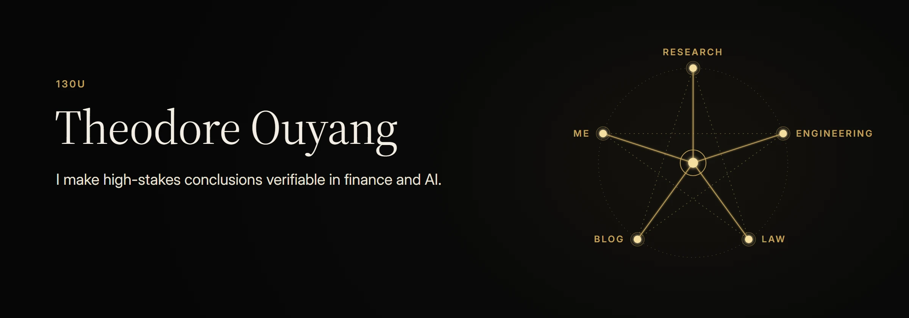
</picture>

<a href="#user-content-research">01 Research</a> &nbsp;·&nbsp; <a href="#user-content-engineering">02 Engineering</a> &nbsp;·&nbsp; <a href="#user-content-law">03 Law</a> &nbsp;·&nbsp; <a href="#user-content-blog">04 Blog</a> &nbsp;·&nbsp; <a href="#user-content-me">05 Me</a>

## 01 &nbsp; Research

Ten works in AI evaluation and mathematical finance. Each starts from a question and ends in a result that can be checked.

<table>
<tr>
<td width="50%" valign="top">
<a href="https://github.com/130U/RESEARCH-Agent-Evaluation-Methodology">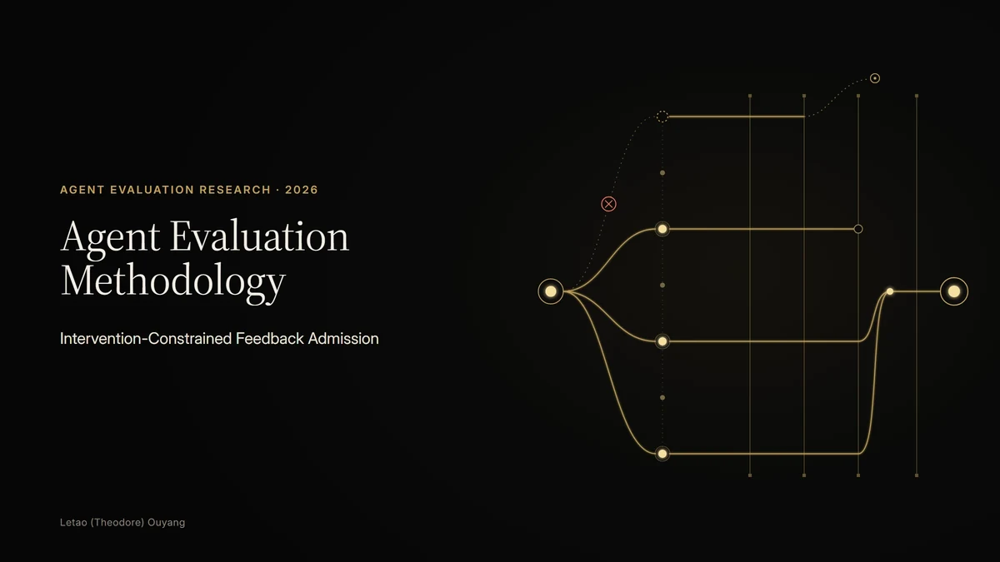</a>

<b><a href="https://github.com/130U/RESEARCH-Agent-Evaluation-Methodology">Agent Evaluation Methodology</a></b> What must be true of a diagnosis before it is allowed to change an agent?

</td>
<td width="50%" valign="top">
<a href="https://github.com/130U/RESEARCH-Financial-Large-Language-Model">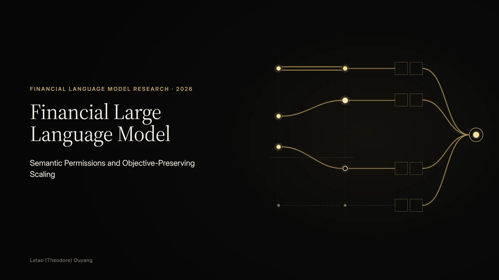</a>

<b><a href="https://github.com/130U/RESEARCH-Financial-Large-Language-Model">Financial Large Language Model</a></b> What should a financial language model be supervised to say, and what must stay fixed while its training scales?

</td>
</tr>
<tr>
<td width="50%" valign="top">
<a href="https://github.com/130U/RESEARCH-Large-Scale-Domain-Expert-Feedback-Governance-and-Adaptive-Review">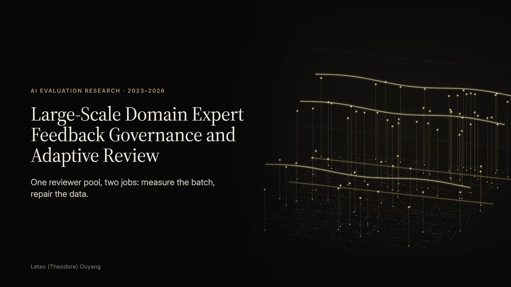</a>

<b><a href="https://github.com/130U/RESEARCH-Large-Scale-Domain-Expert-Feedback-Governance-and-Adaptive-Review">Large-Scale Domain Expert Feedback Governance and Adaptive Review</a></b> How should a post-training program spend a limited pool of expert reviewers when every review does two jobs at once?

</td>
<td width="50%" valign="top">

<b><a href="https://github.com/130U/RESEARCH-Financial-Task-Design-and-Synthetic-Data-Engineering">Financial Task Design and Synthetic Data Engineering</a></b> When a synthetic financial case changes one number, is its label still right?

</td>
</tr>
<tr>
<td width="50%" valign="top">
<a href="https://github.com/130U/RESEARCH-General-Reasoning-Evaluation-and-Layered-Verification">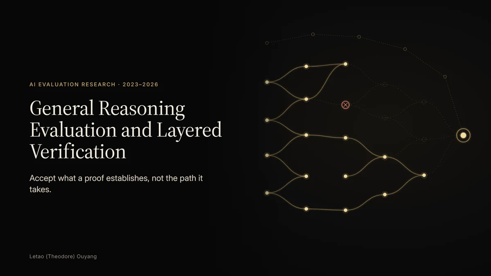</a>

<b><a href="https://github.com/130U/RESEARCH-General-Reasoning-Evaluation-and-Layered-Verification">General Reasoning Evaluation and Layered Verification</a></b> What should entitle a model&#x27;s reasoning to be accepted?

</td>
<td width="50%" valign="top">
<a href="https://github.com/130U/RESEARCH-Evidence-Verification-and-Robust-Comparison-in-Investment-Research">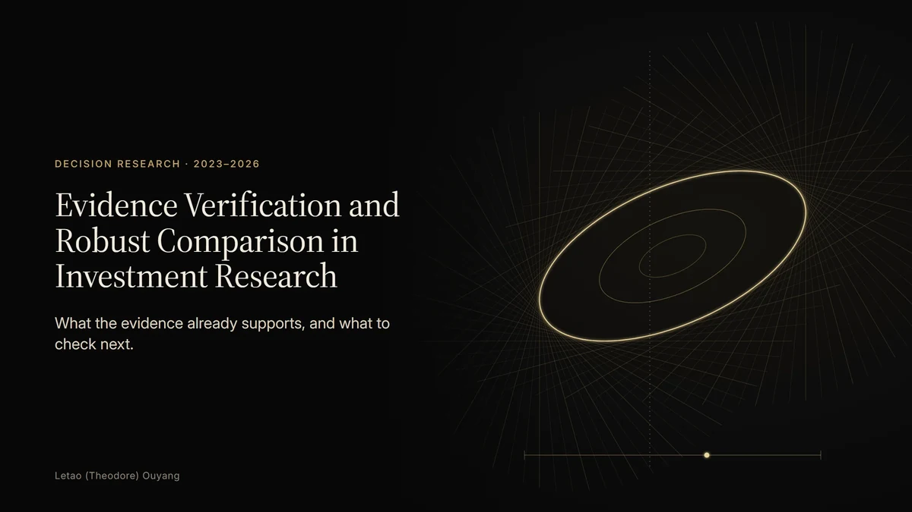</a>

<b><a href="https://github.com/130U/RESEARCH-Evidence-Verification-and-Robust-Comparison-in-Investment-Research">Evidence Verification and Robust Comparison in Investment Research</a></b> Which investment conclusions does the evidence in hand already support, and which fact is most valuable to verify next?

</td>
</tr>
<tr>
<td width="50%" valign="top">
<a href="https://github.com/130U/RESEARCH-Critical-Dependence-Stress-for-Diversification-Gains-under-Fixed-Marginals">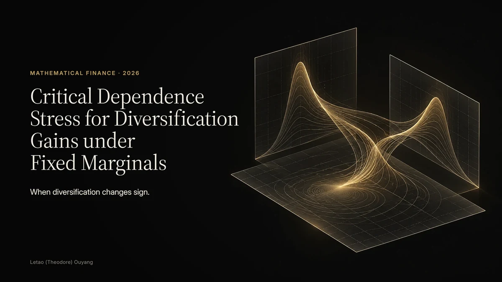</a>

<b><a href="https://github.com/130U/RESEARCH-Critical-Dependence-Stress-for-Diversification-Gains-under-Fixed-Marginals">Critical Dependence Stress for Diversification Gains under Fixed Marginals</a></b> How much dependence stress does it take to overturn a diversification gain?

</td>
<td width="50%" valign="top">

<b><a href="https://github.com/130U/RESEARCH-Certified-Valuation-of-Arithmetic-Asian-Options">Certified Valuation of Arithmetic Asian Options</a></b> What does it cost to exercise an average-price option on the geometric average, and how far is a simulated price from the model that was calibrated?

</td>
</tr>
<tr>
<td width="50%" valign="top">

<b><a href="https://github.com/130U/RESEARCH-Certified-Joint-Pricing-Errors-in-Rough-Heston">Certified Joint Pricing Errors in Rough Heston</a></b> When every strike is priced from one approximate transform, how much numerical error is left in the portfolio?

</td>
<td width="50%" valign="top">
<a href="https://github.com/130U/RESEARCH-Proxy-Tail-Anatomy-of-a-Failed-Research-Line-on-LLM-Evaluation-in-Finance">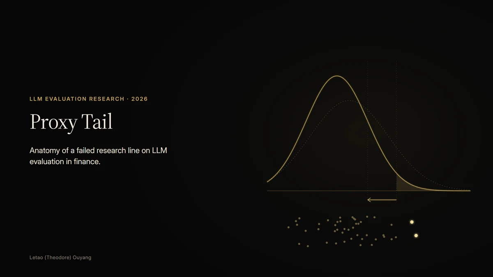</a>

<b><a href="https://github.com/130U/RESEARCH-Proxy-Tail-Anatomy-of-a-Failed-Research-Line-on-LLM-Evaluation-in-Finance">Proxy Tail</a></b> Why did five stages of careful experiments end without a paper, and how early could each stage have been closed?

</td>
</tr>
</table>

## 02 &nbsp; Engineering

Three products built end to end, from interface to tests, and a study series on world models.

<table>
<tr>
<td width="50%" valign="top">

<b><a href="https://github.com/130U/ENGINEERING-Info-Collector-2026">Info Collector</a></b> How does a saved article become part of a library that gets read, when the browser can capture but cannot work, and a model can translate but cannot be trusted?

</td>
<td width="50%" valign="top">

<b><a href="https://github.com/130U/ENGINEERING-BaZi-Context-Agent">BaZi Context Agent</a></b> Which hour was a person born, and what is happening in that life now? I built a system in which the second answer can never change the first.

</td>
</tr>
<tr>
<td width="50%" valign="top">
<a href="https://github.com/130U/ENGINEERING-Divination-and-Destiny-Studies">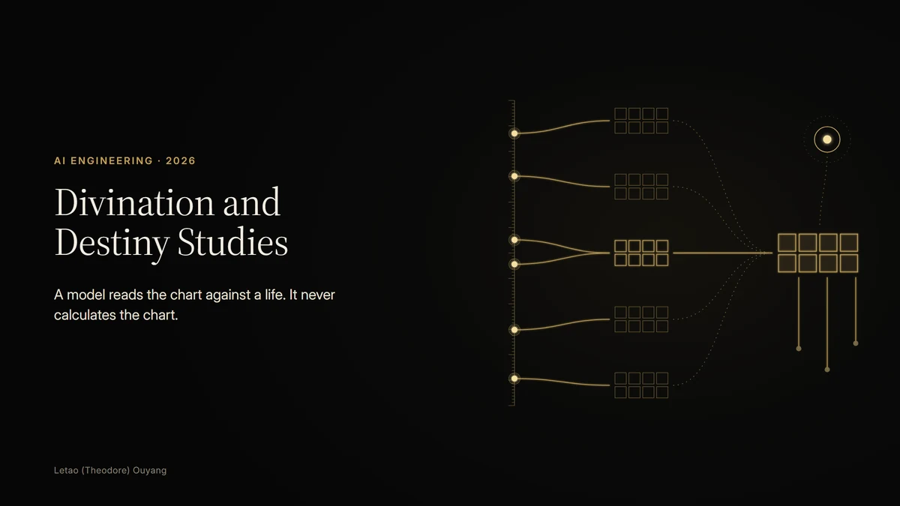</a>

<b><a href="https://github.com/130U/ENGINEERING-Divination-and-Destiny-Studies">Divination and Destiny Studies</a></b> Can a language model read a person&#x27;s chart against their life without ever calculating the chart, seeing a server, or spending anyone&#x27;s money but theirs?

</td>
<td width="50%" valign="top">
<a href="https://github.com/130U/ENGINEERING-World-Model-Series">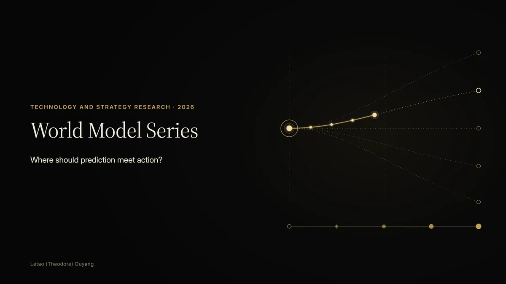</a>

<b><a href="https://github.com/130U/ENGINEERING-World-Model-Series">World Model Series</a></b> A world model is valuable because it predicts the future. A robot, and a business, are valuable only when they act in the present. Where should prediction meet action?

</td>
</tr>
</table>

## 03 &nbsp; Law

Four articles from Duke Law School on who may decide under risk: in orbit, in the climate and on the coast.

<table>
<tr>
<td width="50%" valign="top">

<b><a href="https://github.com/130U/LAW-Autonomous-Authority-in-Space">Autonomous Authority in Space</a></b> When may a space system act without contemporaneous human approval, and which institution decides that it may?

</td>
<td width="50%" valign="top">
<a href="https://github.com/130U/LAW-Small-States-and-the-Governance-of-Strategic-Space-Dependence">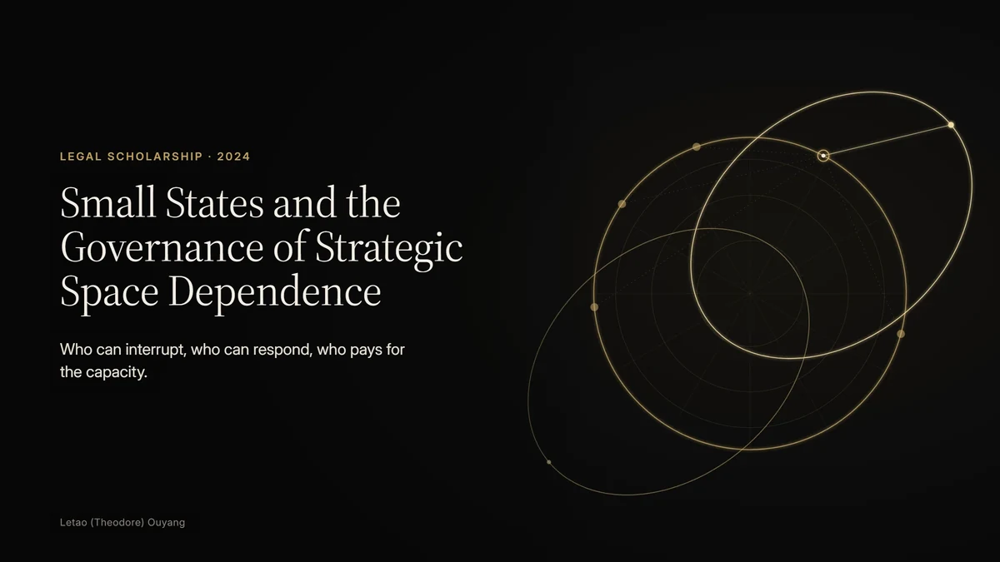</a>

<b><a href="https://github.com/130U/LAW-Small-States-and-the-Governance-of-Strategic-Space-Dependence">Small States and the Governance of Strategic Space Dependence</a></b> When a small state relies on foreign space infrastructure, what exactly has it given up, and what does it owe its own public before it does so?

</td>
</tr>
<tr>
<td width="50%" valign="top">

<b><a href="https://github.com/130U/LAW-Who-May-Choose-the-Lesser-Risk">Who May Choose the Lesser Risk</a></b> Who may choose among climate risks for people who cannot escape the resulting climate, and how can that choice be withdrawn without catastrophe?

</td>
<td width="50%" valign="top">

<b><a href="https://github.com/130U/LAW-Mangrove-Restoration-and-the-Limits-of-Compensatory-Mitigation">Mangrove Restoration and the Limits of Compensatory Mitigation</a></b> What is a promise of future wetland function worth when it is used to permit a loss today?

</td>
</tr>
</table>

## 04 &nbsp; Blog

Music and landscape, each work built as its own site.

<table>
<tr>
<td width="50%" valign="top">

<b><a href="https://github.com/130U/BLOG-Ten-States-of-Water">Ten States of Water</a></b> Ten landscapes of Alaska and Yellowstone, with water in a different state in each.

</td>
<td width="50%" valign="top">
<a href="https://github.com/130U/BLOG-Etude-Sky">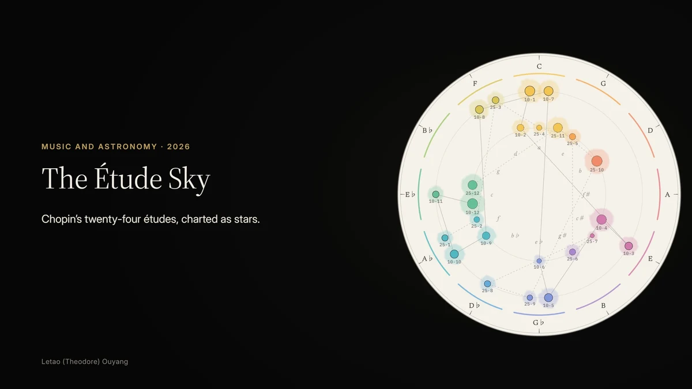</a>

<b><a href="https://github.com/130U/BLOG-Etude-Sky">The Étude Sky</a></b> Chopin&#x27;s twenty-four études, charted as stars on the circle of fifths. Every mark is computed from the music.

</td>
</tr>
<tr>
<td width="50%" valign="top">

<b><a href="https://github.com/130U/BLOG-As-If-Returning">As If Leaving, As If Returning</a></b> A new arrangement of the <i>Der Freischütz</i> fantasy, beneath a Song dynasty handscroll that unrolls with the music, with an essay on beauty across time and aesthetics in the age of AI.

</td>
<td width="50%"></td>
</tr>
</table>

## 05 &nbsp; Me

The site that holds the whole record, and this page.

<table>
<tr>
<td width="50%" valign="top">

<b><a href="https://www.theodoreoy.com/">theodoreoy.com</a></b> Research, experience and writing in one place.

</td>
<td width="50%" valign="top">

<b><a href="https://github.com/130U/130U">130U</a></b> This page: five lists, one configuration file, and a contribution trace refreshed every day.

</td>
</tr>
</table>

<!-- PROFILE_ACTIVITY -->

<picture>
  <source media="(max-width: 767px)" srcset="https://raw.githubusercontent.com/130U/130U/main/assets/generated/contributions-mobile.svg">
  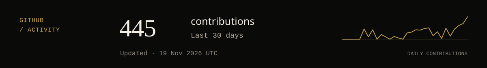
</picture>

[Activity updates](https://github.com/130U/130U/actions/workflows/update-profile.yml) · [Data sources](docs/profile-data.md)
