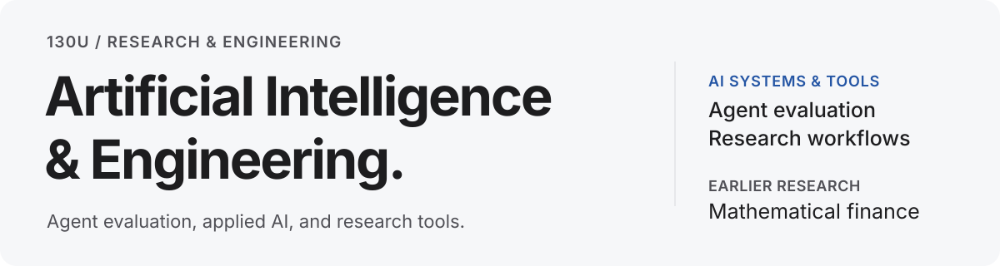
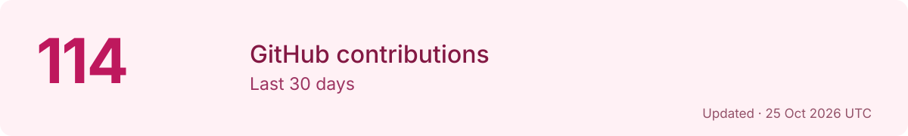

# Theodore Ouyang

**AI research, software engineering, and mathematical finance.**

  <picture>
    <source media="(max-width: 767px) and (prefers-color-scheme: dark)" srcset="https://raw.githubusercontent.com/130U/130U/main/assets/generated/hero-mobile-dark-v3.svg">
    <source media="(max-width: 767px) and (prefers-color-scheme: light)" srcset="https://raw.githubusercontent.com/130U/130U/main/assets/generated/hero-mobile-light-v3.svg">
    <source media="(prefers-color-scheme: dark)" srcset="https://raw.githubusercontent.com/130U/130U/main/assets/generated/hero-dark-v3.svg">
    <source media="(prefers-color-scheme: light)" srcset="https://raw.githubusercontent.com/130U/130U/main/assets/generated/hero-light-v3.svg">
    
  </picture>

I develop mathematical methods and working systems that connect an idea to a result: deterministic pricing-error certificates, intervention-aware agent evaluation, language-model training infrastructure, and research tools with inspectable outputs.

My work combines **proof, implementation, and quantitative verification**. The projects below show the method, the result, and the artifacts behind it.

  <a href="#artificial-intelligence-and-engineering">Artificial Intelligence and Engineering</a>
  &nbsp;&middot;&nbsp;
  <a href="#mathematical-finance">Mathematical Finance</a>

## Artificial Intelligence and Engineering

| Project | Contribution and results |
| --- | --- |
| [Agent Evaluation Methodology](https://github.com/130U/agent-evaluation-methodology) | **ICFA — Intervention-Constrained Feedback Admission:** connects evaluation feedback to action-time evidence, action origin, and the component an optimizer can change. Recorded integrity controls retain **120 valid cases** and identify **440 predefined structural faults**; **36 initialization checks** isolate framework-generated behavior. |
| [Research Portfolio](https://github.com/130U/reserach-portfolio-since2026) | Equation-led robotics analysis and technology landscape research, published in Chinese and English with source registries, company dossiers, claim ledgers, and a ten-page world-model research presentation. |
| [BaZi Context Agent](https://github.com/130U/bazi-context-agent) | A deterministic interpretation engine with birth-hour candidate comparison, isolated user context, structured report generation, and **four evaluation modes**. A public browser experience connects the research pipeline to an interactive product. |
| [Info Collector](https://github.com/130U/info-collector-2026) | An integrated reading workflow: Chrome capture → Chinese translation and summaries → searchable reading desk → Markdown archive → weekly review. |
| [130U-FinLLM](https://github.com/130U/130U-FinLLM) | A financial stance training stack built around a **24.26M-parameter decoder specification**, self-trained BPE, staged training, full-state recovery, and calibration. Saved preparation artifacts contain **5.32M training tokens** with **10,686 candidate headlines excluded before tokenizer training**. |

## Mathematical Finance

### Certified Valuation of Arithmetic Asian Options

A weighted payoff-remainder argument built from a common Gaussian factor, connected to validated transforms for the original projected Euler scheme. The framework combines payoff conversion, projection, inversion, infinite tails, branch control, and outward rounding into a complete pricing-error budget.

**Result:** a deterministic absolute discretization-error bound below **0.011025 price units** for the paper's one-year, twelve-fixing Heston Asian call spread. A separate deterministic-variance coupling example reduces the nonlinear certificate width by approximately **99.4%**.

[Paper](https://github.com/130U/certified-valuation-arithmetic-asian-options/blob/main/manuscript/report.md) · [Code](https://github.com/130U/certified-valuation-arithmetic-asian-options) · [Certificates](https://github.com/130U/certified-valuation-arithmetic-asian-options/blob/main/EVIDENCE.md)

### Certified Joint Pricing Errors in Rough Heston

A continuous fractional Riccati residual-to-price proof chain that preserves the Fourier errors shared across strikes. It produces joint output-error sets for prices, portfolio directions, and finite parameter-candidate comparisons.

**Result:** for the paper's quarter-year 4400–4500 spread, shared-error aggregation tightens the complete bound from **0.252393939 to 0.233318843 index points**, resolving a **0.25-point error budget**. The published study includes **28 portfolio directions**, **five parameter candidates**, and **27 numerical banks**.

[Paper](https://github.com/130U/certified-rough-heston-valuation/blob/main/ARTICLE.md) · [Code](https://github.com/130U/certified-rough-heston-valuation) · [Exact ledgers](https://github.com/130U/certified-rough-heston-valuation/blob/main/EVIDENCE.md)

## GitHub Contributions

  <picture>
    <source media="(max-width: 767px) and (prefers-color-scheme: dark)" srcset="https://raw.githubusercontent.com/130U/130U/main/assets/generated/telemetry-mobile-dark-v4.svg">
    <source media="(max-width: 767px) and (prefers-color-scheme: light)" srcset="https://raw.githubusercontent.com/130U/130U/main/assets/generated/telemetry-mobile-light-v4.svg">
    <source media="(prefers-color-scheme: dark)" srcset="https://raw.githubusercontent.com/130U/130U/main/assets/generated/telemetry-dark-v4.svg">
    <source media="(prefers-color-scheme: light)" srcset="https://raw.githubusercontent.com/130U/130U/main/assets/generated/telemetry-light-v4.svg">
    
  </picture>

Updated daily from GitHub's public contribution calendar. [Update history](https://github.com/130U/130U/actions/workflows/update-profile.yml) · [Data sources](docs/profile-data.md)
