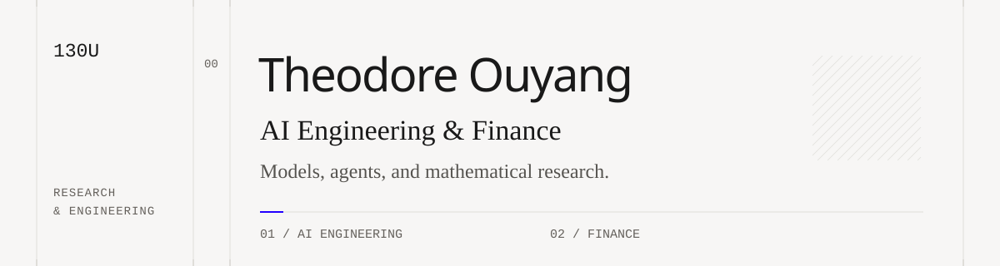
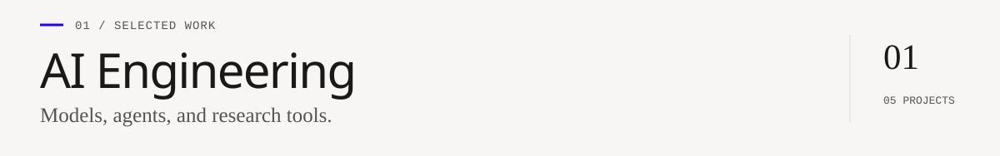
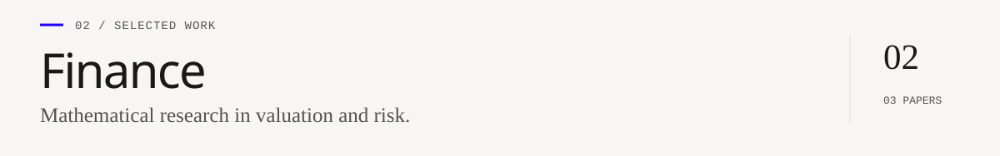
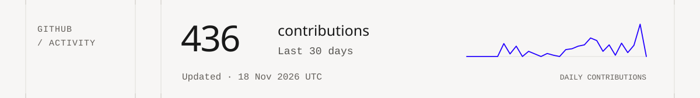

<picture>
  <source media="(max-width: 767px) and (prefers-color-scheme: dark)" srcset="https://raw.githubusercontent.com/130U/130U/main/assets/generated/hero-mobile-dark-v5.svg">
  <source media="(max-width: 767px) and (prefers-color-scheme: light)" srcset="https://raw.githubusercontent.com/130U/130U/main/assets/generated/hero-mobile-light-v5.svg">
  <source media="(prefers-color-scheme: dark)" srcset="https://raw.githubusercontent.com/130U/130U/main/assets/generated/hero-dark-v5.svg">
  <source media="(prefers-color-scheme: light)" srcset="https://raw.githubusercontent.com/130U/130U/main/assets/generated/hero-light-v5.svg">
  
</picture>

I make high-stakes conclusions verifiable in finance and AI.

 

<table width="100%"><tr><td>

<picture>
  <source media="(prefers-color-scheme: dark) and (max-width: 767px)" srcset="https://raw.githubusercontent.com/130U/130U/main/assets/layout/sheet-ai-mobile-dark-v2.svg">
  <source media="(max-width: 767px)" srcset="https://raw.githubusercontent.com/130U/130U/main/assets/layout/sheet-ai-mobile-light-v2.svg">
  <source media="(prefers-color-scheme: dark)" srcset="https://raw.githubusercontent.com/130U/130U/main/assets/layout/sheet-ai-dark-v2.svg">
  
</picture>

<h3>01 &nbsp; Agent Evaluation Methodology</h3>

I built <strong>ICFA</strong>, four gates between evaluation feedback and a prompt optimizer. A diagnosis is admitted when its record is complete, the behavior it criticizes lies within reach of the edit, and the evidence at the moment of action supports it. In 1,824 published runs of a widely used benchmark, every conversation opens with a sentence the framework wrote, and the gates route that critique to the component that can act on it.

<h3>02 &nbsp; Financial Large Language Model</h3>

<strong>Judgment relations · four permissions for every edit · one objective at any split</strong>

I built a financial language model around a judgment relation: who holds which view of what, on which evidence, as of when. Semantic permissions state what the output may and must do under every edit of a text, and a training contract keeps one objective however an update is executed. The public 24M-parameter Trial is trained from random initialization on one Tesla T4.

Method &amp; evidence

 

A sentiment label compresses a change in a fact, the author's attitude and an action into one word. I supervise a judgment relation in its place and state, for every edit and every task axis, what the model's output may and must do. A consistency term on a pair that keeps its label moves both predictions off their calibrated values by up to <strong>half the gap</strong> between the two true posteriors; a one-sided response term on log-odds costs a calibrated model nothing at any margin up to 1.39 nats.

Under the training contract the gradient of one update is the same from four ranks of two microbatches as from a single batch, to about <strong>10⁻⁶</strong>, and projecting only the supervised positions leaves the loss unchanged with a logits tensor <strong>2,048 times smaller</strong>. The Trial reaches a macro-F1 of <strong>0.6549</strong> against a TF-IDF baseline's 0.6087, and all 179 figures in the article are recomputed by the repository's code.

<h3>03 &nbsp; World Model Series</h3>

Three studies of robot learning and world models: where future prediction enters a robot model, how π₀ turns semantics into continuous action, and how world models outside China are delivered and sold.

<h3>04 &nbsp; BaZi Context Agent</h3>

An interactive interpretation system that compares uncertain birth-hour candidates, fixes a working selection, and introduces personal context through a separate reporting layer.

<h3>05 &nbsp; Info Collector</h3>

A reading application that turns saved webpages into translations, summaries, and a searchable local library, with a weekly review of what was read.

</td></tr></table>

 
 

<table width="100%"><tr><td>

<picture>
  <source media="(prefers-color-scheme: dark) and (max-width: 767px)" srcset="https://raw.githubusercontent.com/130U/130U/main/assets/layout/sheet-finance-mobile-dark-v2.svg">
  <source media="(max-width: 767px)" srcset="https://raw.githubusercontent.com/130U/130U/main/assets/layout/sheet-finance-mobile-light-v2.svg">
  <source media="(prefers-color-scheme: dark)" srcset="https://raw.githubusercontent.com/130U/130U/main/assets/layout/sheet-finance-dark-v2.svg">
  
</picture>

<h3>01 &nbsp; Arithmetic Asian Options</h3>

I bound the cost of exercising an arithmetic Asian option on its geometric average by a dispersion divided by a level risk. For a calendar-month crude oil option the bound is below a hundredth of a cent per barrel. Under Heston it gives a proved price interval 16 basis points wide for a twelve-fixing 95–110 call spread, with the 768-step Euler price within <strong>0.011025</strong> of the continuous one.

Method &amp; evidence

 

Oil, metals and currency hedges pay on an arithmetic average, which has no closed-form law; the geometric average does. Exercising on a scaled geometric average costs the expected overshoot when the two averages fall on opposite sides of the strike. I prove that this cost is at most a dispersion divided by a level risk, for every model with a common Gaussian factor, and derive its cubic law in Black's model.

For a one-month crude oil average price option, one to twelve months ahead, the closed-form value is proved to be within <strong>0.0023 to 0.0081 cents</strong> of the Black price. Under Heston, the continuous price of the twelve-fixing 95–110 call spread lies in <strong>[6.508371733, 6.518868974]</strong>, with projection, inversion tails, periodization and rounding inside the interval.

<h3>02 &nbsp; Joint Pricing Errors in Rough Heston</h3>

I establish joint pricing-error bounds that retain Fourier perturbations shared across strikes, using a finite-history theorem for fractional Riccati residuals. For the paper’s quarter-year 4400–4500 call spread, the stored output has a complete error upper bound of <strong>0.233318843 index points</strong>, meeting a <strong>0.25-point budget</strong>.

Method &amp; evidence

 

I establish a deterministic framework for joint pricing-error certification in rough Heston. A finite-history theorem carries continuous fractional Riccati residuals into the pricing exponent, while a joint error set preserves the Fourier perturbations shared across strikes. Together, these results provide rigorous bounds for spreads and portfolio valuations sharing the same model and maturity.

For the paper’s quarter-year <strong>4400–4500 call spread</strong>, the framework certifies the stored numerical output with a complete error upper bound of <strong>0.233318843 index points</strong>, meeting a <strong>0.25-point accuracy budget</strong>. The certificate includes quadrature, omitted frequencies, the infinite tail and arithmetic, connecting fractional dynamics to a checkable guarantee for the valuation.

<h3>03 &nbsp; Critical Dependence Stress</h3>

For small reallocations in an exchangeable box model, I derive a <strong>common quadratic law</strong> for the dependence-stress budgets that erase or reverse diversification gains under fixed marginals. In the independent uniform benchmark with median Expected Shortfall, equal exposures, and transport weights (1, 1, 2), the critical coefficient is <strong>at least 30% above</strong> the tangent prediction.

Method &amp; evidence

 

I develop a reverse stress-testing theory for a precise portfolio decision: how much can dependence change before a diversification gain disappears, with every marginal loss distribution held fixed? For small reallocations in an exchangeable box model, I derive a <strong>common quadratic law</strong> for the stress budgets that produce a tie or a strict reversal. The analysis connects a variational limit with exact marginal restoration and identifies the extra cost that local sensitivity alone misses.

In the independent uniform benchmark with median Expected Shortfall, equal exposures, and transport weights (1, 1, 2), I bound the critical coefficient between <strong>0.203125 and 0.302083...</strong>, <strong>at least 30% above</strong> the tangent prediction of 0.15625. The paper also characterizes when the restoration premium vanishes and uses continuous maximum-flow/minimum-cut duality to explain how the background portfolio absorbs stress.

</td></tr></table>

 

<!-- PROFILE_ACTIVITY -->

---

<picture>
  <source media="(max-width: 767px) and (prefers-color-scheme: dark)" srcset="https://raw.githubusercontent.com/130U/130U/main/assets/generated/telemetry-mobile-dark-v5.svg">
  <source media="(max-width: 767px) and (prefers-color-scheme: light)" srcset="https://raw.githubusercontent.com/130U/130U/main/assets/generated/telemetry-mobile-light-v5.svg">
  <source media="(prefers-color-scheme: dark)" srcset="https://raw.githubusercontent.com/130U/130U/main/assets/generated/telemetry-dark-v5.svg">
  <source media="(prefers-color-scheme: light)" srcset="https://raw.githubusercontent.com/130U/130U/main/assets/generated/telemetry-light-v5.svg">
  
</picture>

[Activity updates](https://github.com/130U/130U/actions/workflows/update-profile.yml) · [Data sources](docs/profile-data.md)
