<picture>
  <source media="(max-width: 601px), (min-width: 768px) and (max-width: 889px)" srcset="https://raw.githubusercontent.com/130U/130U/main/assets/hero-mobile.webp">
  
</picture>

<a href="https://github.com/stars/130U/lists/research"><picture><source media="(max-width: 1099px)" srcset="https://raw.githubusercontent.com/130U/130U/main/assets/ledger/blank.svg"><source media="(prefers-color-scheme: dark)" srcset="https://raw.githubusercontent.com/130U/130U/main/assets/ledger/wide-dark/research.svg">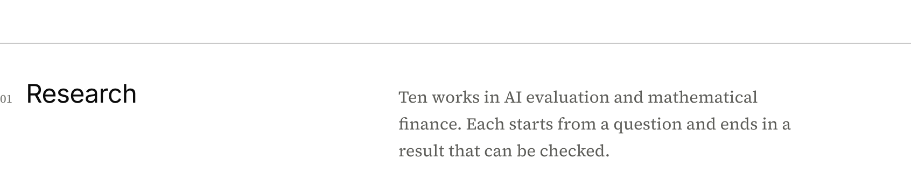</picture><picture><source media="(max-width: 511px), (min-width: 768px) and (max-width: 789px), (min-width: 1100px)" srcset="https://raw.githubusercontent.com/130U/130U/main/assets/ledger/blank.svg"><source media="(prefers-color-scheme: dark)" srcset="https://raw.githubusercontent.com/130U/130U/main/assets/ledger/medium-dark/research.svg">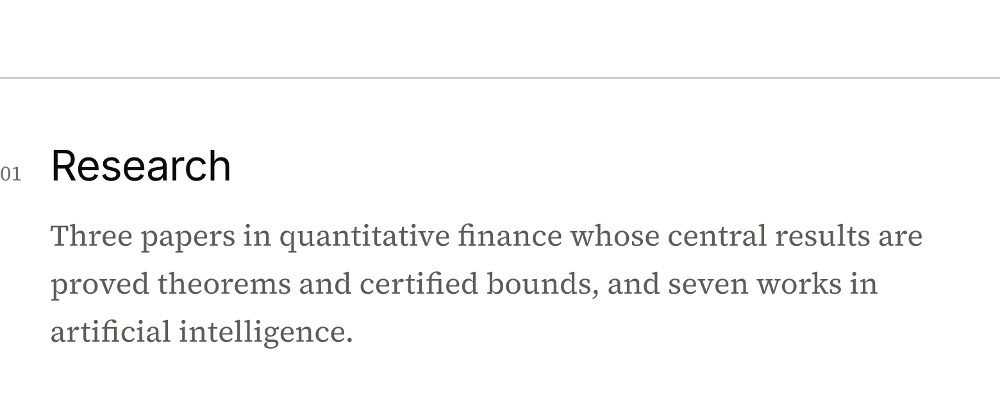</picture><picture><source media="(min-width: 512px) and (max-width: 767px), (min-width: 790px)" srcset="https://raw.githubusercontent.com/130U/130U/main/assets/ledger/blank.svg"><source media="(prefers-color-scheme: dark)" srcset="https://raw.githubusercontent.com/130U/130U/main/assets/ledger/narrow-dark/research.svg">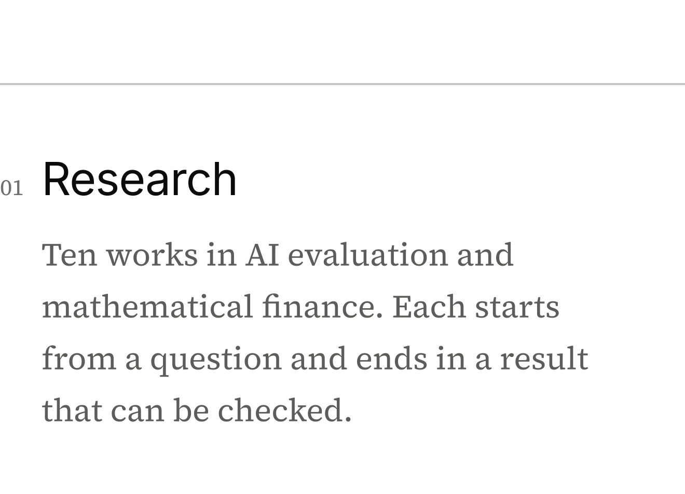</picture></a>
<a href="https://github.com/130U/RESEARCH-Critical-Dependence-Stress-for-Diversification-Gains-under-Fixed-Marginals"><picture><source media="(max-width: 1099px)" srcset="https://raw.githubusercontent.com/130U/130U/main/assets/ledger/blank.svg"><source media="(prefers-color-scheme: dark)" srcset="https://raw.githubusercontent.com/130U/130U/main/assets/ledger/wide-dark/critical-dependence-stress.svg"></picture><picture><source media="(max-width: 511px), (min-width: 768px) and (max-width: 789px), (min-width: 1100px)" srcset="https://raw.githubusercontent.com/130U/130U/main/assets/ledger/blank.svg"><source media="(prefers-color-scheme: dark)" srcset="https://raw.githubusercontent.com/130U/130U/main/assets/ledger/medium-dark/critical-dependence-stress.svg">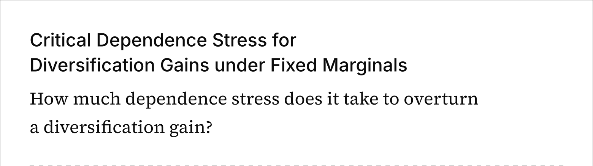</picture><picture><source media="(min-width: 512px) and (max-width: 767px), (min-width: 790px)" srcset="https://raw.githubusercontent.com/130U/130U/main/assets/ledger/blank.svg"><source media="(prefers-color-scheme: dark)" srcset="https://raw.githubusercontent.com/130U/130U/main/assets/ledger/narrow-dark/critical-dependence-stress.svg">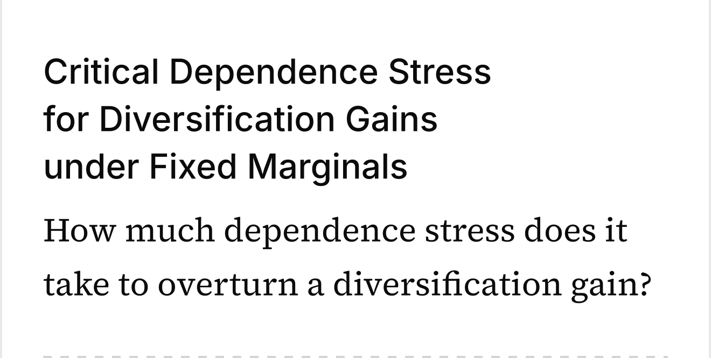</picture></a>
<a href="https://github.com/130U/RESEARCH-Certified-Valuation-of-Arithmetic-Asian-Options"><picture><source media="(max-width: 1099px)" srcset="https://raw.githubusercontent.com/130U/130U/main/assets/ledger/blank.svg"><source media="(prefers-color-scheme: dark)" srcset="https://raw.githubusercontent.com/130U/130U/main/assets/ledger/wide-dark/arithmetic-asian-options.svg">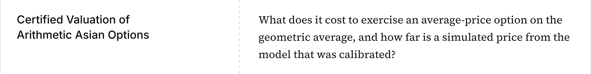</picture><picture><source media="(max-width: 511px), (min-width: 768px) and (max-width: 789px), (min-width: 1100px)" srcset="https://raw.githubusercontent.com/130U/130U/main/assets/ledger/blank.svg"><source media="(prefers-color-scheme: dark)" srcset="https://raw.githubusercontent.com/130U/130U/main/assets/ledger/medium-dark/arithmetic-asian-options.svg">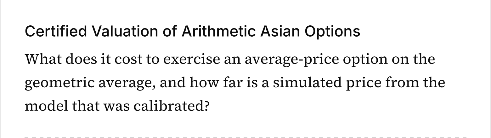</picture><picture><source media="(min-width: 512px) and (max-width: 767px), (min-width: 790px)" srcset="https://raw.githubusercontent.com/130U/130U/main/assets/ledger/blank.svg"><source media="(prefers-color-scheme: dark)" srcset="https://raw.githubusercontent.com/130U/130U/main/assets/ledger/narrow-dark/arithmetic-asian-options.svg">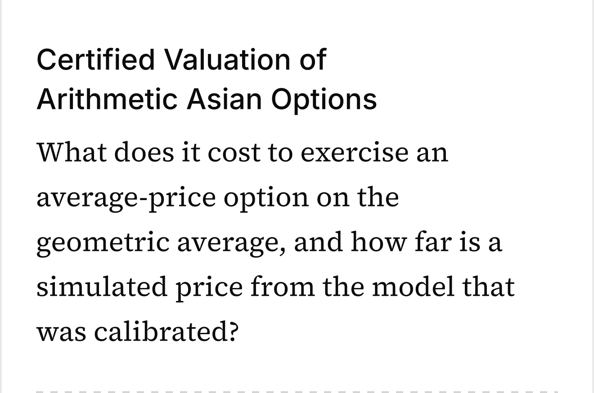</picture></a>
<a href="https://github.com/130U/RESEARCH-Certified-Joint-Pricing-Errors-in-Rough-Heston"><picture><source media="(max-width: 1099px)" srcset="https://raw.githubusercontent.com/130U/130U/main/assets/ledger/blank.svg"><source media="(prefers-color-scheme: dark)" srcset="https://raw.githubusercontent.com/130U/130U/main/assets/ledger/wide-dark/rough-heston.svg"></picture><picture><source media="(max-width: 511px), (min-width: 768px) and (max-width: 789px), (min-width: 1100px)" srcset="https://raw.githubusercontent.com/130U/130U/main/assets/ledger/blank.svg"><source media="(prefers-color-scheme: dark)" srcset="https://raw.githubusercontent.com/130U/130U/main/assets/ledger/medium-dark/rough-heston.svg"></picture><picture><source media="(min-width: 512px) and (max-width: 767px), (min-width: 790px)" srcset="https://raw.githubusercontent.com/130U/130U/main/assets/ledger/blank.svg"><source media="(prefers-color-scheme: dark)" srcset="https://raw.githubusercontent.com/130U/130U/main/assets/ledger/narrow-dark/rough-heston.svg">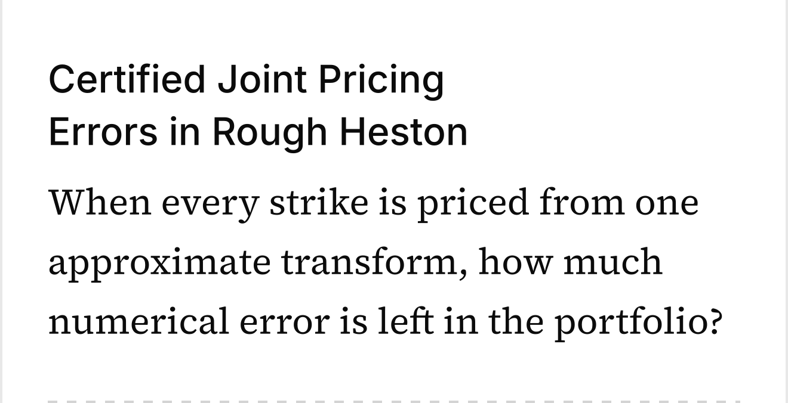</picture></a>
<a href="https://github.com/130U/RESEARCH-Financial-Large-Language-Model"><picture><source media="(max-width: 1099px)" srcset="https://raw.githubusercontent.com/130U/130U/main/assets/ledger/blank.svg"><source media="(prefers-color-scheme: dark)" srcset="https://raw.githubusercontent.com/130U/130U/main/assets/ledger/wide-dark/financial-large-language-model.svg"></picture><picture><source media="(max-width: 511px), (min-width: 768px) and (max-width: 789px), (min-width: 1100px)" srcset="https://raw.githubusercontent.com/130U/130U/main/assets/ledger/blank.svg"><source media="(prefers-color-scheme: dark)" srcset="https://raw.githubusercontent.com/130U/130U/main/assets/ledger/medium-dark/financial-large-language-model.svg"></picture><picture><source media="(min-width: 512px) and (max-width: 767px), (min-width: 790px)" srcset="https://raw.githubusercontent.com/130U/130U/main/assets/ledger/blank.svg"><source media="(prefers-color-scheme: dark)" srcset="https://raw.githubusercontent.com/130U/130U/main/assets/ledger/narrow-dark/financial-large-language-model.svg">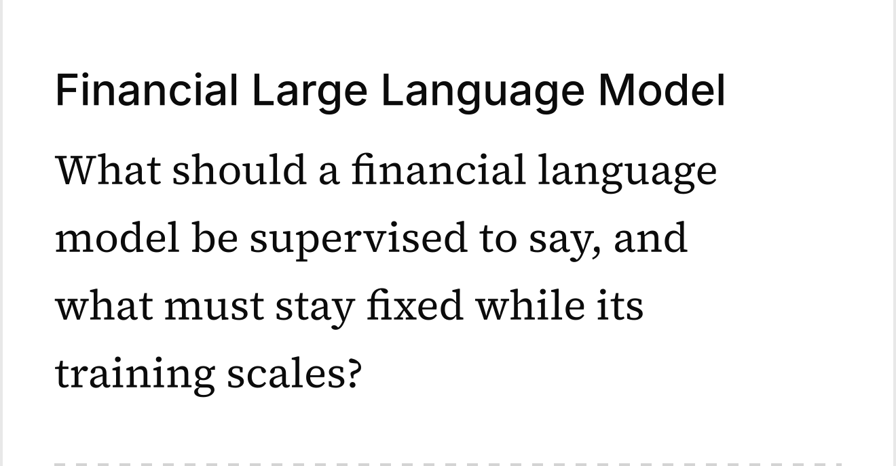</picture></a>
<a href="https://github.com/130U/RESEARCH-Agent-Evaluation-Methodology"><picture><source media="(max-width: 1099px)" srcset="https://raw.githubusercontent.com/130U/130U/main/assets/ledger/blank.svg"><source media="(prefers-color-scheme: dark)" srcset="https://raw.githubusercontent.com/130U/130U/main/assets/ledger/wide-dark/agent-evaluation-methodology.svg"></picture><picture><source media="(max-width: 511px), (min-width: 768px) and (max-width: 789px), (min-width: 1100px)" srcset="https://raw.githubusercontent.com/130U/130U/main/assets/ledger/blank.svg"><source media="(prefers-color-scheme: dark)" srcset="https://raw.githubusercontent.com/130U/130U/main/assets/ledger/medium-dark/agent-evaluation-methodology.svg"></picture><picture><source media="(min-width: 512px) and (max-width: 767px), (min-width: 790px)" srcset="https://raw.githubusercontent.com/130U/130U/main/assets/ledger/blank.svg"><source media="(prefers-color-scheme: dark)" srcset="https://raw.githubusercontent.com/130U/130U/main/assets/ledger/narrow-dark/agent-evaluation-methodology.svg">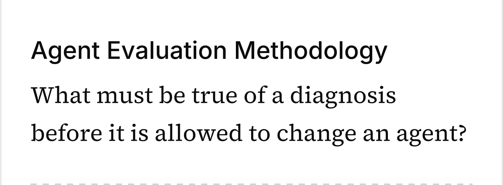</picture></a>
<a href="https://github.com/130U/RESEARCH-Large-Scale-Domain-Expert-Feedback-Governance-and-Adaptive-Review"><picture><source media="(max-width: 1099px)" srcset="https://raw.githubusercontent.com/130U/130U/main/assets/ledger/blank.svg"><source media="(prefers-color-scheme: dark)" srcset="https://raw.githubusercontent.com/130U/130U/main/assets/ledger/wide-dark/expert-feedback-governance.svg"></picture><picture><source media="(max-width: 511px), (min-width: 768px) and (max-width: 789px), (min-width: 1100px)" srcset="https://raw.githubusercontent.com/130U/130U/main/assets/ledger/blank.svg"><source media="(prefers-color-scheme: dark)" srcset="https://raw.githubusercontent.com/130U/130U/main/assets/ledger/medium-dark/expert-feedback-governance.svg">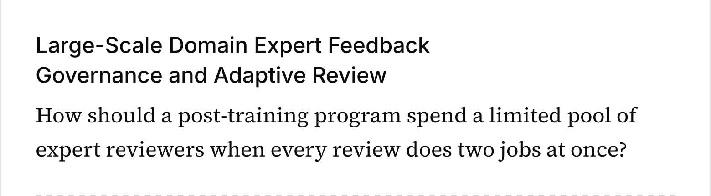</picture><picture><source media="(min-width: 512px) and (max-width: 767px), (min-width: 790px)" srcset="https://raw.githubusercontent.com/130U/130U/main/assets/ledger/blank.svg"><source media="(prefers-color-scheme: dark)" srcset="https://raw.githubusercontent.com/130U/130U/main/assets/ledger/narrow-dark/expert-feedback-governance.svg">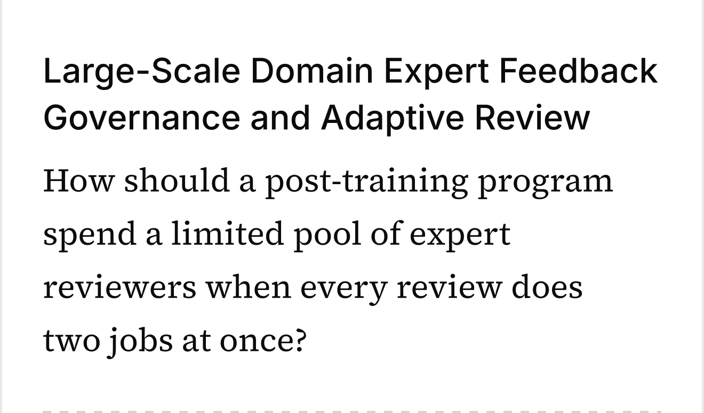</picture></a>
<a href="https://github.com/130U/RESEARCH-Financial-Task-Design-and-Synthetic-Data-Engineering"><picture><source media="(max-width: 1099px)" srcset="https://raw.githubusercontent.com/130U/130U/main/assets/ledger/blank.svg"><source media="(prefers-color-scheme: dark)" srcset="https://raw.githubusercontent.com/130U/130U/main/assets/ledger/wide-dark/financial-task-design.svg"></picture><picture><source media="(max-width: 511px), (min-width: 768px) and (max-width: 789px), (min-width: 1100px)" srcset="https://raw.githubusercontent.com/130U/130U/main/assets/ledger/blank.svg"><source media="(prefers-color-scheme: dark)" srcset="https://raw.githubusercontent.com/130U/130U/main/assets/ledger/medium-dark/financial-task-design.svg">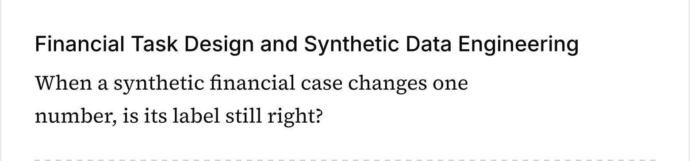</picture><picture><source media="(min-width: 512px) and (max-width: 767px), (min-width: 790px)" srcset="https://raw.githubusercontent.com/130U/130U/main/assets/ledger/blank.svg"><source media="(prefers-color-scheme: dark)" srcset="https://raw.githubusercontent.com/130U/130U/main/assets/ledger/narrow-dark/financial-task-design.svg">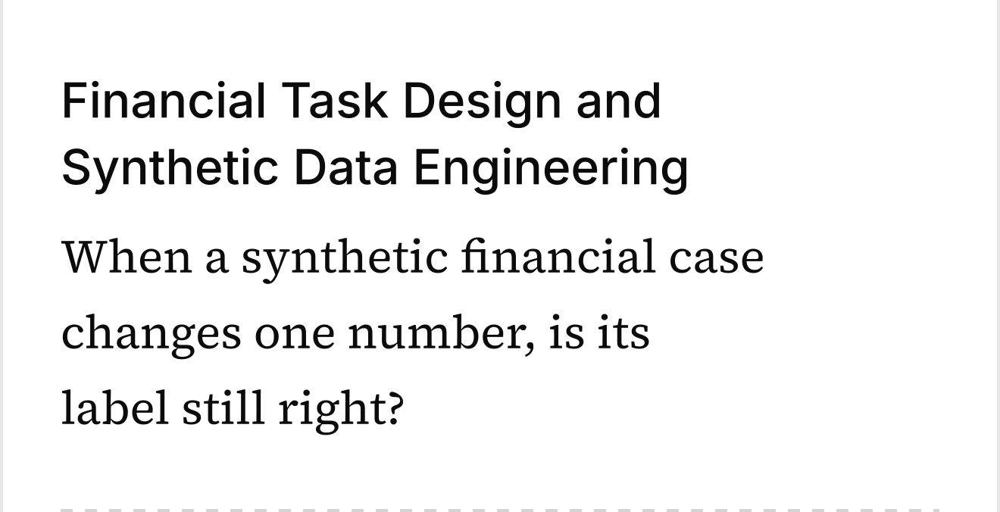</picture></a>
<a href="https://github.com/130U/RESEARCH-General-Reasoning-Evaluation-and-Layered-Verification"><picture><source media="(max-width: 1099px)" srcset="https://raw.githubusercontent.com/130U/130U/main/assets/ledger/blank.svg"><source media="(prefers-color-scheme: dark)" srcset="https://raw.githubusercontent.com/130U/130U/main/assets/ledger/wide-dark/reasoning-evaluation.svg"></picture><picture><source media="(max-width: 511px), (min-width: 768px) and (max-width: 789px), (min-width: 1100px)" srcset="https://raw.githubusercontent.com/130U/130U/main/assets/ledger/blank.svg"><source media="(prefers-color-scheme: dark)" srcset="https://raw.githubusercontent.com/130U/130U/main/assets/ledger/medium-dark/reasoning-evaluation.svg"></picture><picture><source media="(min-width: 512px) and (max-width: 767px), (min-width: 790px)" srcset="https://raw.githubusercontent.com/130U/130U/main/assets/ledger/blank.svg"><source media="(prefers-color-scheme: dark)" srcset="https://raw.githubusercontent.com/130U/130U/main/assets/ledger/narrow-dark/reasoning-evaluation.svg">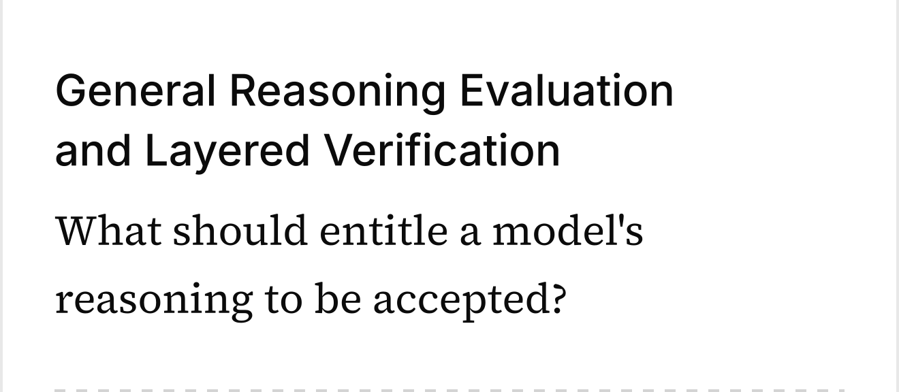</picture></a>
<a href="https://github.com/130U/RESEARCH-Evidence-Verification-and-Robust-Comparison-in-Investment-Research"><picture><source media="(max-width: 1099px)" srcset="https://raw.githubusercontent.com/130U/130U/main/assets/ledger/blank.svg"><source media="(prefers-color-scheme: dark)" srcset="https://raw.githubusercontent.com/130U/130U/main/assets/ledger/wide-dark/evidence-verification.svg"></picture><picture><source media="(max-width: 511px), (min-width: 768px) and (max-width: 789px), (min-width: 1100px)" srcset="https://raw.githubusercontent.com/130U/130U/main/assets/ledger/blank.svg"><source media="(prefers-color-scheme: dark)" srcset="https://raw.githubusercontent.com/130U/130U/main/assets/ledger/medium-dark/evidence-verification.svg">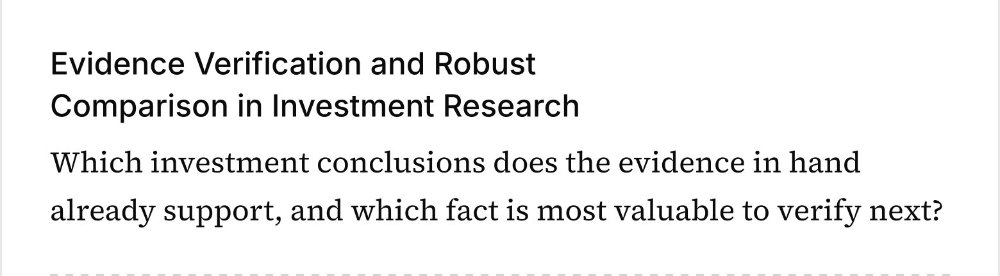</picture><picture><source media="(min-width: 512px) and (max-width: 767px), (min-width: 790px)" srcset="https://raw.githubusercontent.com/130U/130U/main/assets/ledger/blank.svg"><source media="(prefers-color-scheme: dark)" srcset="https://raw.githubusercontent.com/130U/130U/main/assets/ledger/narrow-dark/evidence-verification.svg">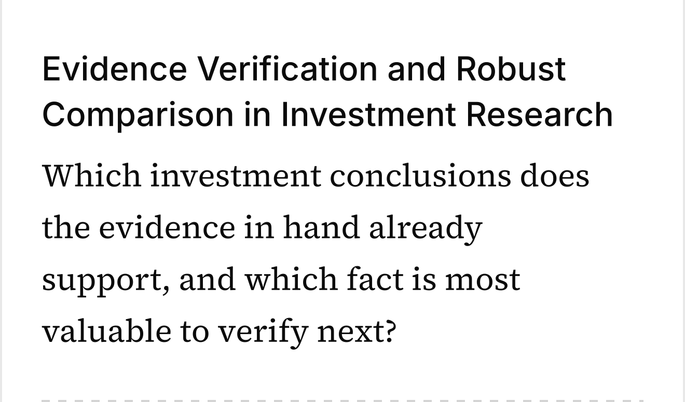</picture></a>
<a href="https://github.com/130U/RESEARCH-Proxy-Tail-Anatomy-of-a-Failed-Research-Line-on-LLM-Evaluation-in-Finance"><picture><source media="(max-width: 1099px)" srcset="https://raw.githubusercontent.com/130U/130U/main/assets/ledger/blank.svg"><source media="(prefers-color-scheme: dark)" srcset="https://raw.githubusercontent.com/130U/130U/main/assets/ledger/wide-dark/proxy-tail.svg"></picture><picture><source media="(max-width: 511px), (min-width: 768px) and (max-width: 789px), (min-width: 1100px)" srcset="https://raw.githubusercontent.com/130U/130U/main/assets/ledger/blank.svg"><source media="(prefers-color-scheme: dark)" srcset="https://raw.githubusercontent.com/130U/130U/main/assets/ledger/medium-dark/proxy-tail.svg"></picture><picture><source media="(min-width: 512px) and (max-width: 767px), (min-width: 790px)" srcset="https://raw.githubusercontent.com/130U/130U/main/assets/ledger/blank.svg"><source media="(prefers-color-scheme: dark)" srcset="https://raw.githubusercontent.com/130U/130U/main/assets/ledger/narrow-dark/proxy-tail.svg"></picture></a>

<a href="https://github.com/stars/130U/lists/engineering"><picture><source media="(max-width: 1099px)" srcset="https://raw.githubusercontent.com/130U/130U/main/assets/ledger/blank.svg"><source media="(prefers-color-scheme: dark)" srcset="https://raw.githubusercontent.com/130U/130U/main/assets/ledger/wide-dark/engineering.svg"></picture><picture><source media="(max-width: 511px), (min-width: 768px) and (max-width: 789px), (min-width: 1100px)" srcset="https://raw.githubusercontent.com/130U/130U/main/assets/ledger/blank.svg"><source media="(prefers-color-scheme: dark)" srcset="https://raw.githubusercontent.com/130U/130U/main/assets/ledger/medium-dark/engineering.svg">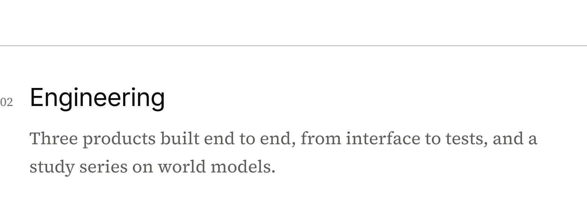</picture><picture><source media="(min-width: 512px) and (max-width: 767px), (min-width: 790px)" srcset="https://raw.githubusercontent.com/130U/130U/main/assets/ledger/blank.svg"><source media="(prefers-color-scheme: dark)" srcset="https://raw.githubusercontent.com/130U/130U/main/assets/ledger/narrow-dark/engineering.svg">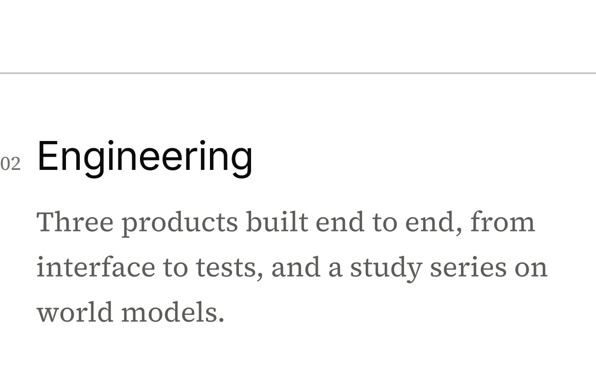</picture></a>
<a href="https://github.com/130U/ENGINEERING-Info-Collector-2026"><picture><source media="(max-width: 1099px)" srcset="https://raw.githubusercontent.com/130U/130U/main/assets/ledger/blank.svg"><source media="(prefers-color-scheme: dark)" srcset="https://raw.githubusercontent.com/130U/130U/main/assets/ledger/wide-dark/info-collector.svg"></picture><picture><source media="(max-width: 511px), (min-width: 768px) and (max-width: 789px), (min-width: 1100px)" srcset="https://raw.githubusercontent.com/130U/130U/main/assets/ledger/blank.svg"><source media="(prefers-color-scheme: dark)" srcset="https://raw.githubusercontent.com/130U/130U/main/assets/ledger/medium-dark/info-collector.svg">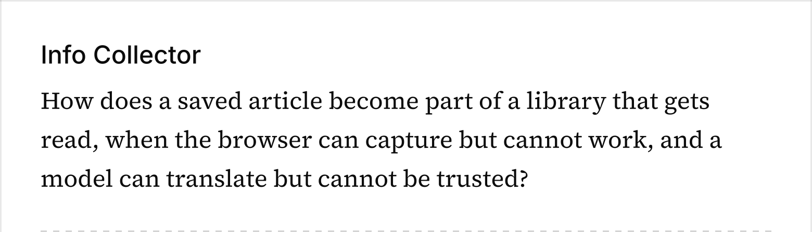</picture><picture><source media="(min-width: 512px) and (max-width: 767px), (min-width: 790px)" srcset="https://raw.githubusercontent.com/130U/130U/main/assets/ledger/blank.svg"><source media="(prefers-color-scheme: dark)" srcset="https://raw.githubusercontent.com/130U/130U/main/assets/ledger/narrow-dark/info-collector.svg">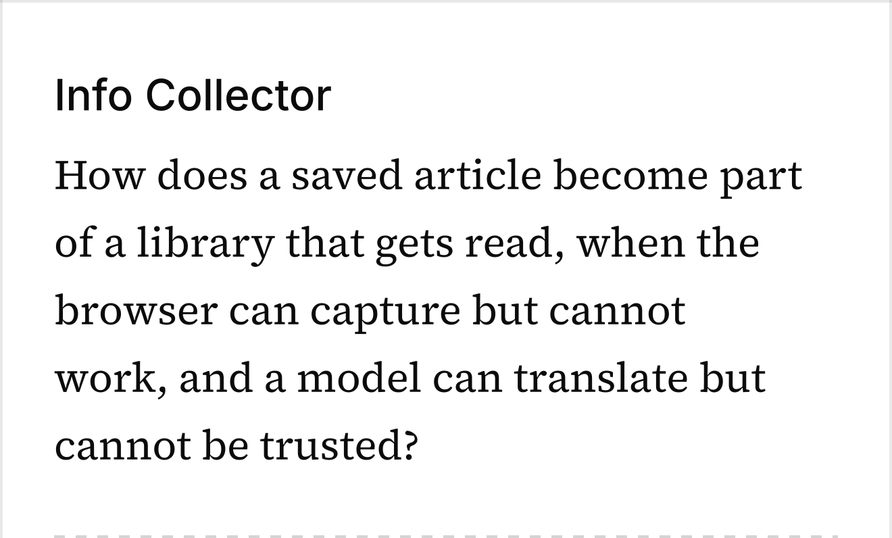</picture></a>
<a href="https://github.com/130U/ENGINEERING-BaZi-Context-Agent"><picture><source media="(max-width: 1099px)" srcset="https://raw.githubusercontent.com/130U/130U/main/assets/ledger/blank.svg"><source media="(prefers-color-scheme: dark)" srcset="https://raw.githubusercontent.com/130U/130U/main/assets/ledger/wide-dark/bazi-context-agent.svg"></picture><picture><source media="(max-width: 511px), (min-width: 768px) and (max-width: 789px), (min-width: 1100px)" srcset="https://raw.githubusercontent.com/130U/130U/main/assets/ledger/blank.svg"><source media="(prefers-color-scheme: dark)" srcset="https://raw.githubusercontent.com/130U/130U/main/assets/ledger/medium-dark/bazi-context-agent.svg"></picture><picture><source media="(min-width: 512px) and (max-width: 767px), (min-width: 790px)" srcset="https://raw.githubusercontent.com/130U/130U/main/assets/ledger/blank.svg"><source media="(prefers-color-scheme: dark)" srcset="https://raw.githubusercontent.com/130U/130U/main/assets/ledger/narrow-dark/bazi-context-agent.svg">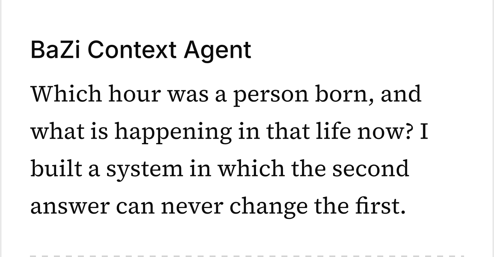</picture></a>
<a href="https://github.com/130U/ENGINEERING-Divination-and-Destiny-Studies"><picture><source media="(max-width: 1099px)" srcset="https://raw.githubusercontent.com/130U/130U/main/assets/ledger/blank.svg"><source media="(prefers-color-scheme: dark)" srcset="https://raw.githubusercontent.com/130U/130U/main/assets/ledger/wide-dark/divination-and-destiny-studies.svg"></picture><picture><source media="(max-width: 511px), (min-width: 768px) and (max-width: 789px), (min-width: 1100px)" srcset="https://raw.githubusercontent.com/130U/130U/main/assets/ledger/blank.svg"><source media="(prefers-color-scheme: dark)" srcset="https://raw.githubusercontent.com/130U/130U/main/assets/ledger/medium-dark/divination-and-destiny-studies.svg">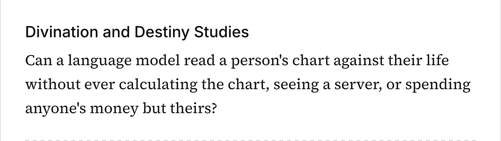</picture><picture><source media="(min-width: 512px) and (max-width: 767px), (min-width: 790px)" srcset="https://raw.githubusercontent.com/130U/130U/main/assets/ledger/blank.svg"><source media="(prefers-color-scheme: dark)" srcset="https://raw.githubusercontent.com/130U/130U/main/assets/ledger/narrow-dark/divination-and-destiny-studies.svg">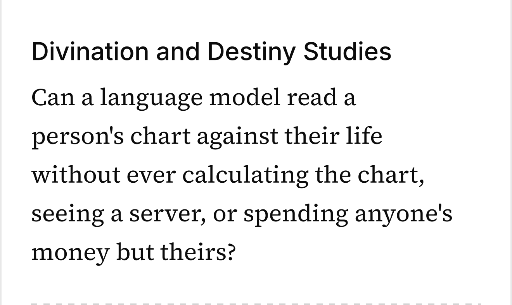</picture></a>
<a href="https://github.com/130U/ENGINEERING-World-Model-Series"><picture><source media="(max-width: 1099px)" srcset="https://raw.githubusercontent.com/130U/130U/main/assets/ledger/blank.svg"><source media="(prefers-color-scheme: dark)" srcset="https://raw.githubusercontent.com/130U/130U/main/assets/ledger/wide-dark/world-model-series.svg"></picture><picture><source media="(max-width: 511px), (min-width: 768px) and (max-width: 789px), (min-width: 1100px)" srcset="https://raw.githubusercontent.com/130U/130U/main/assets/ledger/blank.svg"><source media="(prefers-color-scheme: dark)" srcset="https://raw.githubusercontent.com/130U/130U/main/assets/ledger/medium-dark/world-model-series.svg">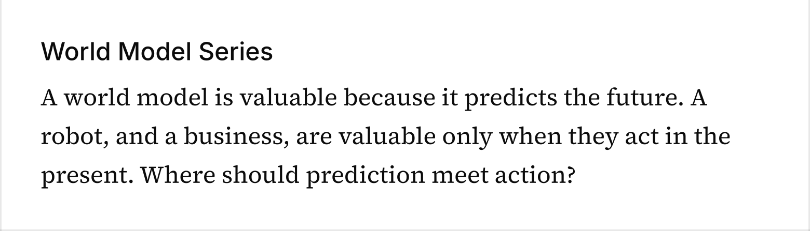</picture><picture><source media="(min-width: 512px) and (max-width: 767px), (min-width: 790px)" srcset="https://raw.githubusercontent.com/130U/130U/main/assets/ledger/blank.svg"><source media="(prefers-color-scheme: dark)" srcset="https://raw.githubusercontent.com/130U/130U/main/assets/ledger/narrow-dark/world-model-series.svg">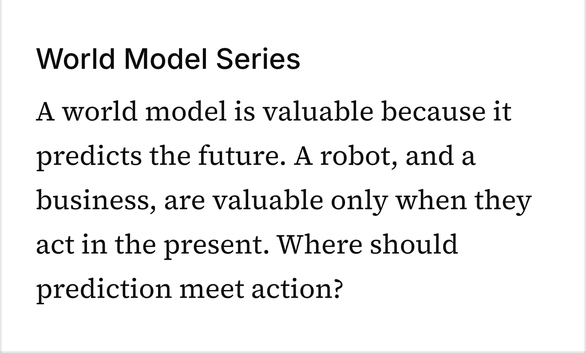</picture></a>

<a href="https://github.com/stars/130U/lists/law"><picture><source media="(max-width: 1099px)" srcset="https://raw.githubusercontent.com/130U/130U/main/assets/ledger/blank.svg"><source media="(prefers-color-scheme: dark)" srcset="https://raw.githubusercontent.com/130U/130U/main/assets/ledger/wide-dark/law.svg">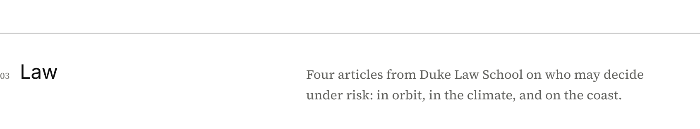</picture><picture><source media="(max-width: 511px), (min-width: 768px) and (max-width: 789px), (min-width: 1100px)" srcset="https://raw.githubusercontent.com/130U/130U/main/assets/ledger/blank.svg"><source media="(prefers-color-scheme: dark)" srcset="https://raw.githubusercontent.com/130U/130U/main/assets/ledger/medium-dark/law.svg">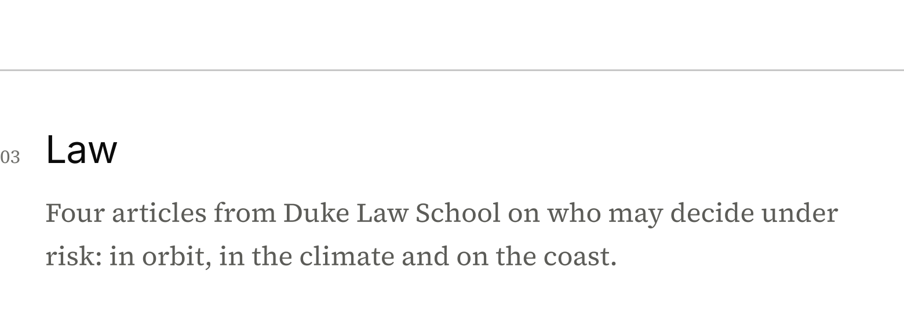</picture><picture><source media="(min-width: 512px) and (max-width: 767px), (min-width: 790px)" srcset="https://raw.githubusercontent.com/130U/130U/main/assets/ledger/blank.svg"><source media="(prefers-color-scheme: dark)" srcset="https://raw.githubusercontent.com/130U/130U/main/assets/ledger/narrow-dark/law.svg">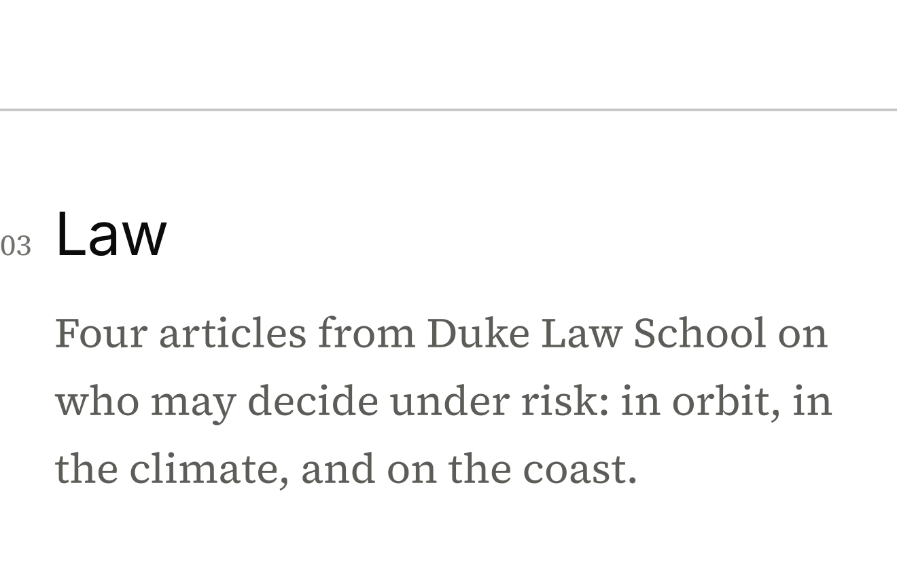</picture></a>
<a href="https://github.com/130U/LAW-Autonomous-Authority-in-Space"><picture><source media="(max-width: 1099px)" srcset="https://raw.githubusercontent.com/130U/130U/main/assets/ledger/blank.svg"><source media="(prefers-color-scheme: dark)" srcset="https://raw.githubusercontent.com/130U/130U/main/assets/ledger/wide-dark/autonomous-authority-in-space.svg"></picture><picture><source media="(max-width: 511px), (min-width: 768px) and (max-width: 789px), (min-width: 1100px)" srcset="https://raw.githubusercontent.com/130U/130U/main/assets/ledger/blank.svg"><source media="(prefers-color-scheme: dark)" srcset="https://raw.githubusercontent.com/130U/130U/main/assets/ledger/medium-dark/autonomous-authority-in-space.svg">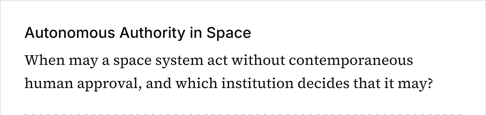</picture><picture><source media="(min-width: 512px) and (max-width: 767px), (min-width: 790px)" srcset="https://raw.githubusercontent.com/130U/130U/main/assets/ledger/blank.svg"><source media="(prefers-color-scheme: dark)" srcset="https://raw.githubusercontent.com/130U/130U/main/assets/ledger/narrow-dark/autonomous-authority-in-space.svg">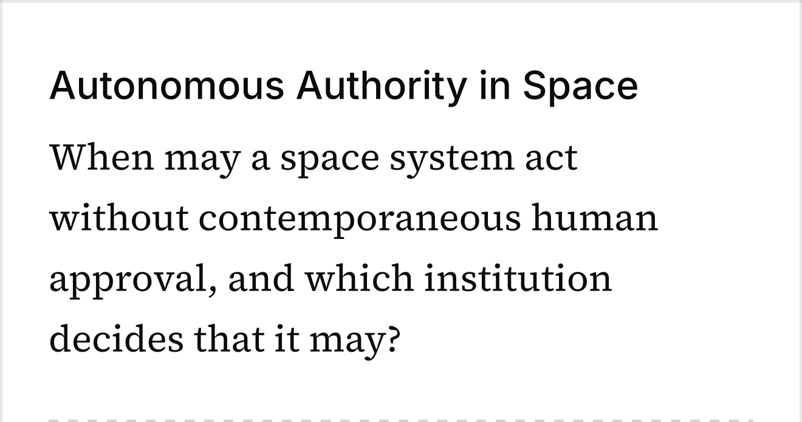</picture></a>
<a href="https://github.com/130U/LAW-Small-States-and-the-Governance-of-Strategic-Space-Dependence"><picture><source media="(max-width: 1099px)" srcset="https://raw.githubusercontent.com/130U/130U/main/assets/ledger/blank.svg"><source media="(prefers-color-scheme: dark)" srcset="https://raw.githubusercontent.com/130U/130U/main/assets/ledger/wide-dark/small-states.svg"></picture><picture><source media="(max-width: 511px), (min-width: 768px) and (max-width: 789px), (min-width: 1100px)" srcset="https://raw.githubusercontent.com/130U/130U/main/assets/ledger/blank.svg"><source media="(prefers-color-scheme: dark)" srcset="https://raw.githubusercontent.com/130U/130U/main/assets/ledger/medium-dark/small-states.svg"></picture><picture><source media="(min-width: 512px) and (max-width: 767px), (min-width: 790px)" srcset="https://raw.githubusercontent.com/130U/130U/main/assets/ledger/blank.svg"><source media="(prefers-color-scheme: dark)" srcset="https://raw.githubusercontent.com/130U/130U/main/assets/ledger/narrow-dark/small-states.svg"></picture></a>
<a href="https://github.com/130U/LAW-Who-May-Choose-the-Lesser-Risk"><picture><source media="(max-width: 1099px)" srcset="https://raw.githubusercontent.com/130U/130U/main/assets/ledger/blank.svg"><source media="(prefers-color-scheme: dark)" srcset="https://raw.githubusercontent.com/130U/130U/main/assets/ledger/wide-dark/lesser-risk.svg"></picture><picture><source media="(max-width: 511px), (min-width: 768px) and (max-width: 789px), (min-width: 1100px)" srcset="https://raw.githubusercontent.com/130U/130U/main/assets/ledger/blank.svg"><source media="(prefers-color-scheme: dark)" srcset="https://raw.githubusercontent.com/130U/130U/main/assets/ledger/medium-dark/lesser-risk.svg"></picture><picture><source media="(min-width: 512px) and (max-width: 767px), (min-width: 790px)" srcset="https://raw.githubusercontent.com/130U/130U/main/assets/ledger/blank.svg"><source media="(prefers-color-scheme: dark)" srcset="https://raw.githubusercontent.com/130U/130U/main/assets/ledger/narrow-dark/lesser-risk.svg">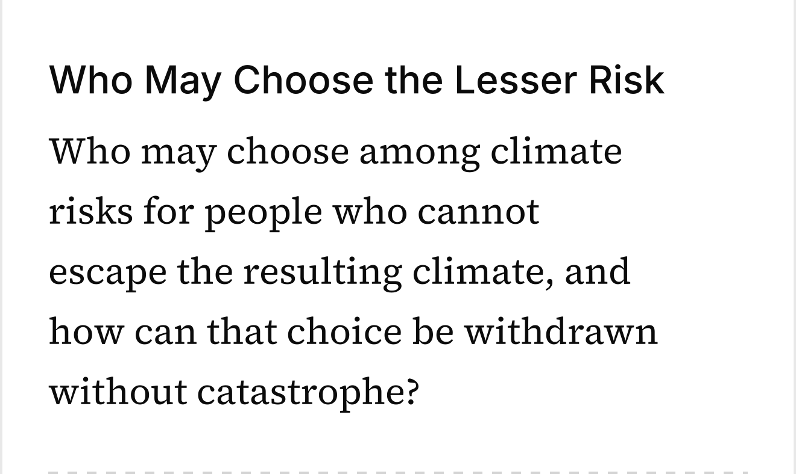</picture></a>
<a href="https://github.com/130U/LAW-Mangrove-Restoration-and-the-Limits-of-Compensatory-Mitigation"><picture><source media="(max-width: 1099px)" srcset="https://raw.githubusercontent.com/130U/130U/main/assets/ledger/blank.svg"><source media="(prefers-color-scheme: dark)" srcset="https://raw.githubusercontent.com/130U/130U/main/assets/ledger/wide-dark/mangrove-restoration.svg"></picture><picture><source media="(max-width: 511px), (min-width: 768px) and (max-width: 789px), (min-width: 1100px)" srcset="https://raw.githubusercontent.com/130U/130U/main/assets/ledger/blank.svg"><source media="(prefers-color-scheme: dark)" srcset="https://raw.githubusercontent.com/130U/130U/main/assets/ledger/medium-dark/mangrove-restoration.svg"></picture><picture><source media="(min-width: 512px) and (max-width: 767px), (min-width: 790px)" srcset="https://raw.githubusercontent.com/130U/130U/main/assets/ledger/blank.svg"><source media="(prefers-color-scheme: dark)" srcset="https://raw.githubusercontent.com/130U/130U/main/assets/ledger/narrow-dark/mangrove-restoration.svg">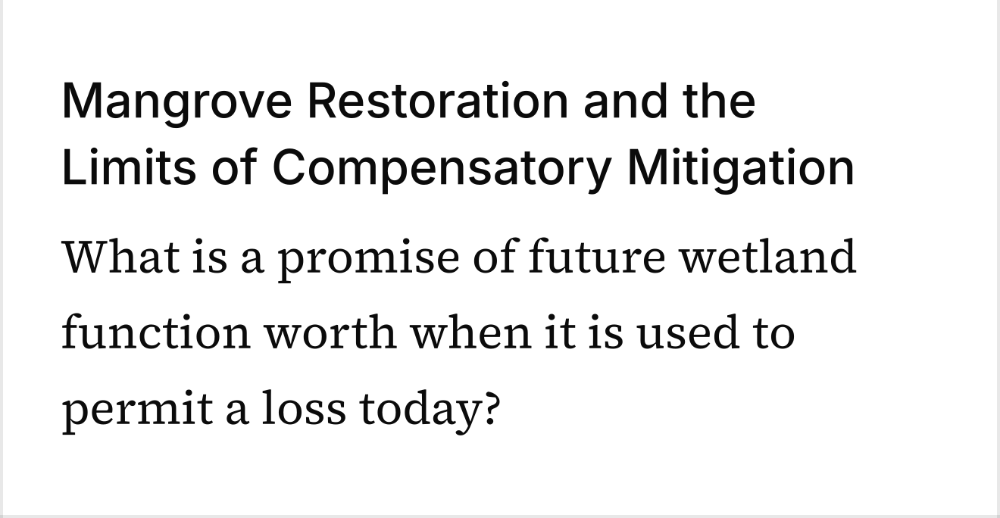</picture></a>

<a href="https://github.com/stars/130U/lists/blog"><picture><source media="(max-width: 1099px)" srcset="https://raw.githubusercontent.com/130U/130U/main/assets/ledger/blank.svg"><source media="(prefers-color-scheme: dark)" srcset="https://raw.githubusercontent.com/130U/130U/main/assets/ledger/wide-dark/blog.svg"></picture><picture><source media="(max-width: 511px), (min-width: 768px) and (max-width: 789px), (min-width: 1100px)" srcset="https://raw.githubusercontent.com/130U/130U/main/assets/ledger/blank.svg"><source media="(prefers-color-scheme: dark)" srcset="https://raw.githubusercontent.com/130U/130U/main/assets/ledger/medium-dark/blog.svg">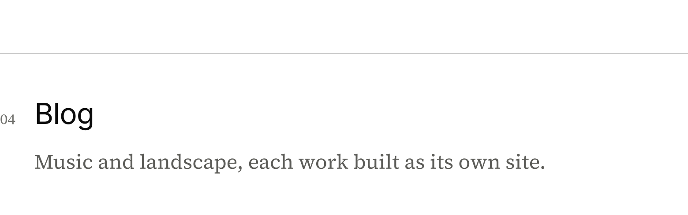</picture><picture><source media="(min-width: 512px) and (max-width: 767px), (min-width: 790px)" srcset="https://raw.githubusercontent.com/130U/130U/main/assets/ledger/blank.svg"><source media="(prefers-color-scheme: dark)" srcset="https://raw.githubusercontent.com/130U/130U/main/assets/ledger/narrow-dark/blog.svg">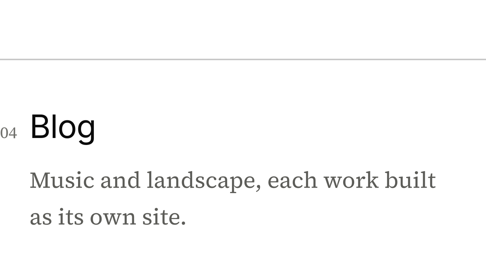</picture></a>
<a href="https://github.com/130U/BLOG-Ten-States-of-Water"><picture><source media="(max-width: 1099px)" srcset="https://raw.githubusercontent.com/130U/130U/main/assets/ledger/blank.svg"><source media="(prefers-color-scheme: dark)" srcset="https://raw.githubusercontent.com/130U/130U/main/assets/ledger/wide-dark/ten-states-of-water.svg"></picture><picture><source media="(max-width: 511px), (min-width: 768px) and (max-width: 789px), (min-width: 1100px)" srcset="https://raw.githubusercontent.com/130U/130U/main/assets/ledger/blank.svg"><source media="(prefers-color-scheme: dark)" srcset="https://raw.githubusercontent.com/130U/130U/main/assets/ledger/medium-dark/ten-states-of-water.svg">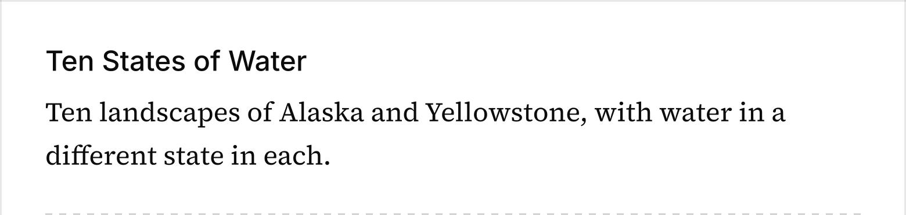</picture><picture><source media="(min-width: 512px) and (max-width: 767px), (min-width: 790px)" srcset="https://raw.githubusercontent.com/130U/130U/main/assets/ledger/blank.svg"><source media="(prefers-color-scheme: dark)" srcset="https://raw.githubusercontent.com/130U/130U/main/assets/ledger/narrow-dark/ten-states-of-water.svg"></picture></a>
<a href="https://github.com/130U/BLOG-Etude-Sky"><picture><source media="(max-width: 1099px)" srcset="https://raw.githubusercontent.com/130U/130U/main/assets/ledger/blank.svg"><source media="(prefers-color-scheme: dark)" srcset="https://raw.githubusercontent.com/130U/130U/main/assets/ledger/wide-dark/etude-sky.svg"></picture><picture><source media="(max-width: 511px), (min-width: 768px) and (max-width: 789px), (min-width: 1100px)" srcset="https://raw.githubusercontent.com/130U/130U/main/assets/ledger/blank.svg"><source media="(prefers-color-scheme: dark)" srcset="https://raw.githubusercontent.com/130U/130U/main/assets/ledger/medium-dark/etude-sky.svg"></picture><picture><source media="(min-width: 512px) and (max-width: 767px), (min-width: 790px)" srcset="https://raw.githubusercontent.com/130U/130U/main/assets/ledger/blank.svg"><source media="(prefers-color-scheme: dark)" srcset="https://raw.githubusercontent.com/130U/130U/main/assets/ledger/narrow-dark/etude-sky.svg">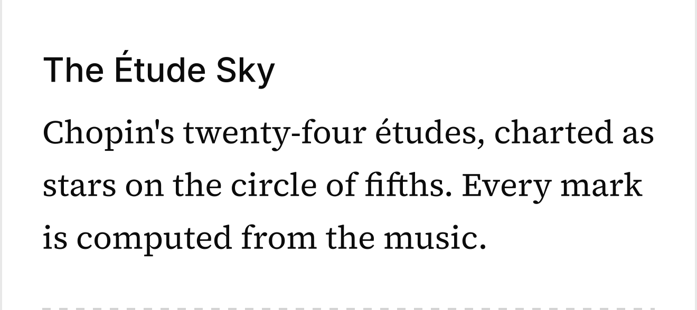</picture></a>
<a href="https://github.com/130U/BLOG-As-If-Returning"><picture><source media="(max-width: 1099px)" srcset="https://raw.githubusercontent.com/130U/130U/main/assets/ledger/blank.svg"><source media="(prefers-color-scheme: dark)" srcset="https://raw.githubusercontent.com/130U/130U/main/assets/ledger/wide-dark/as-if-returning.svg">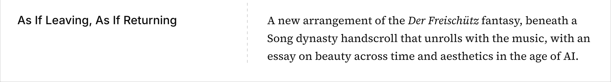</picture><picture><source media="(max-width: 511px), (min-width: 768px) and (max-width: 789px), (min-width: 1100px)" srcset="https://raw.githubusercontent.com/130U/130U/main/assets/ledger/blank.svg"><source media="(prefers-color-scheme: dark)" srcset="https://raw.githubusercontent.com/130U/130U/main/assets/ledger/medium-dark/as-if-returning.svg">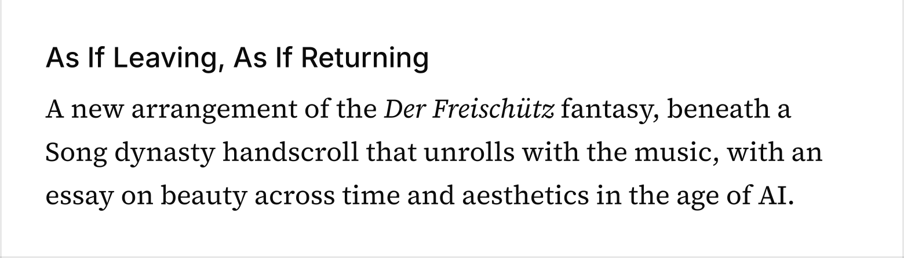</picture><picture><source media="(min-width: 512px) and (max-width: 767px), (min-width: 790px)" srcset="https://raw.githubusercontent.com/130U/130U/main/assets/ledger/blank.svg"><source media="(prefers-color-scheme: dark)" srcset="https://raw.githubusercontent.com/130U/130U/main/assets/ledger/narrow-dark/as-if-returning.svg">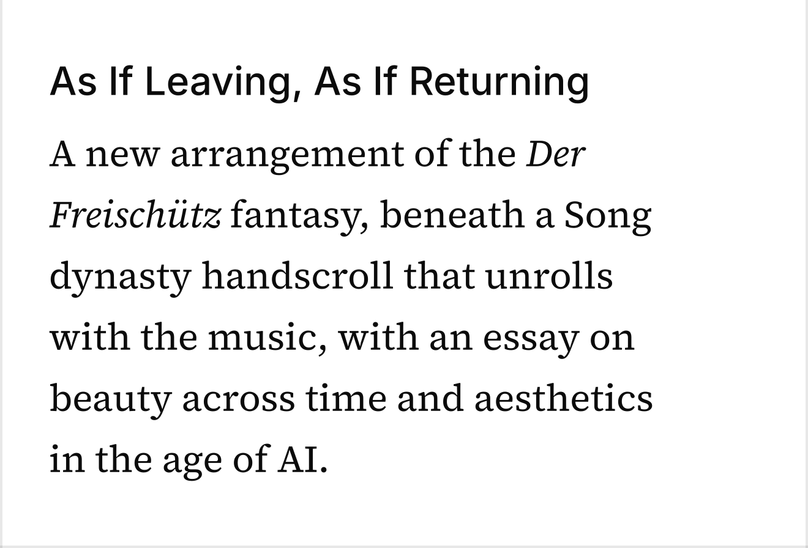</picture></a>

<a href="https://github.com/stars/130U/lists/me"><picture><source media="(max-width: 1099px)" srcset="https://raw.githubusercontent.com/130U/130U/main/assets/ledger/blank.svg"><source media="(prefers-color-scheme: dark)" srcset="https://raw.githubusercontent.com/130U/130U/main/assets/ledger/wide-dark/me.svg"></picture><picture><source media="(max-width: 511px), (min-width: 768px) and (max-width: 789px), (min-width: 1100px)" srcset="https://raw.githubusercontent.com/130U/130U/main/assets/ledger/blank.svg"><source media="(prefers-color-scheme: dark)" srcset="https://raw.githubusercontent.com/130U/130U/main/assets/ledger/medium-dark/me.svg"></picture><picture><source media="(min-width: 512px) and (max-width: 767px), (min-width: 790px)" srcset="https://raw.githubusercontent.com/130U/130U/main/assets/ledger/blank.svg"><source media="(prefers-color-scheme: dark)" srcset="https://raw.githubusercontent.com/130U/130U/main/assets/ledger/narrow-dark/me.svg">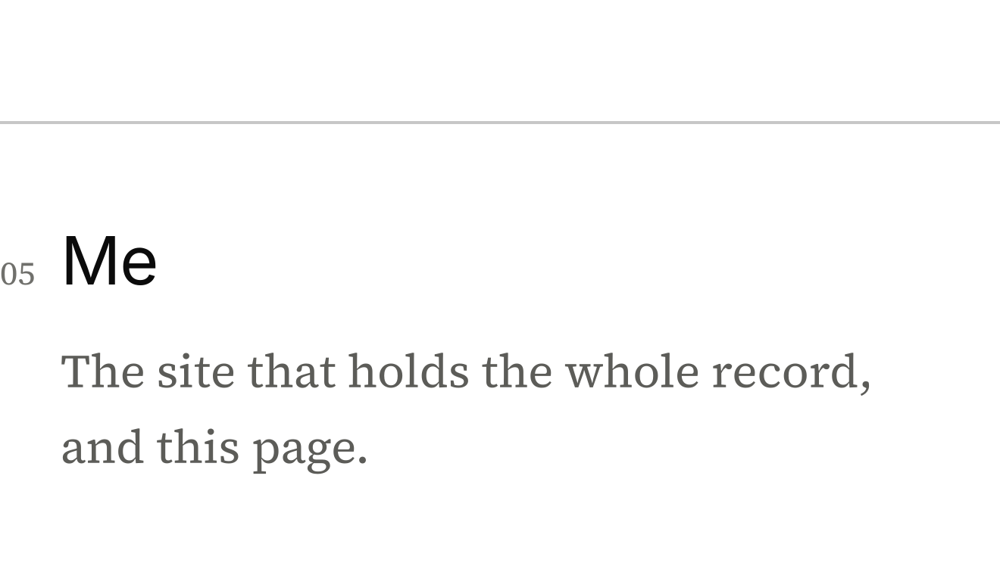</picture></a>
<a href="https://www.theodoreoy.com/"><picture><source media="(max-width: 1099px)" srcset="https://raw.githubusercontent.com/130U/130U/main/assets/ledger/blank.svg"><source media="(prefers-color-scheme: dark)" srcset="https://raw.githubusercontent.com/130U/130U/main/assets/ledger/wide-dark/website.svg"></picture><picture><source media="(max-width: 511px), (min-width: 768px) and (max-width: 789px), (min-width: 1100px)" srcset="https://raw.githubusercontent.com/130U/130U/main/assets/ledger/blank.svg"><source media="(prefers-color-scheme: dark)" srcset="https://raw.githubusercontent.com/130U/130U/main/assets/ledger/medium-dark/website.svg"></picture><picture><source media="(min-width: 512px) and (max-width: 767px), (min-width: 790px)" srcset="https://raw.githubusercontent.com/130U/130U/main/assets/ledger/blank.svg"><source media="(prefers-color-scheme: dark)" srcset="https://raw.githubusercontent.com/130U/130U/main/assets/ledger/narrow-dark/website.svg"></picture></a>
<a href="https://github.com/130U/130U"><picture><source media="(max-width: 1099px)" srcset="https://raw.githubusercontent.com/130U/130U/main/assets/ledger/blank.svg"><source media="(prefers-color-scheme: dark)" srcset="https://raw.githubusercontent.com/130U/130U/main/assets/ledger/wide-dark/profile.svg"></picture><picture><source media="(max-width: 511px), (min-width: 768px) and (max-width: 789px), (min-width: 1100px)" srcset="https://raw.githubusercontent.com/130U/130U/main/assets/ledger/blank.svg"><source media="(prefers-color-scheme: dark)" srcset="https://raw.githubusercontent.com/130U/130U/main/assets/ledger/medium-dark/profile.svg"></picture><picture><source media="(min-width: 512px) and (max-width: 767px), (min-width: 790px)" srcset="https://raw.githubusercontent.com/130U/130U/main/assets/ledger/blank.svg"><source media="(prefers-color-scheme: dark)" srcset="https://raw.githubusercontent.com/130U/130U/main/assets/ledger/narrow-dark/profile.svg">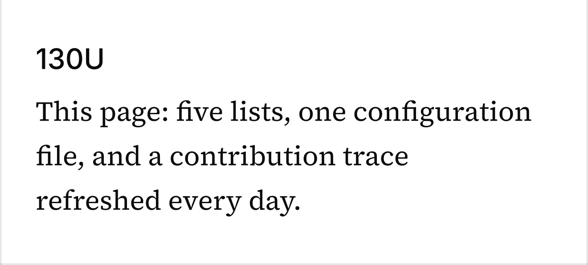</picture></a>

<!-- PROFILE_ACTIVITY -->

<a href="docs/profile-data.md"><picture><source media="(max-width: 1099px)" srcset="https://raw.githubusercontent.com/130U/130U/main/assets/ledger/blank.svg"><source media="(prefers-color-scheme: dark)" srcset="https://raw.githubusercontent.com/130U/130U/main/assets/generated/wide-dark/contributions.svg">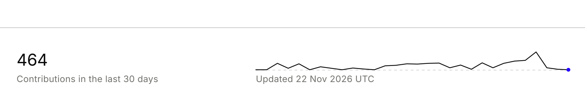</picture><picture><source media="(max-width: 511px), (min-width: 768px) and (max-width: 789px), (min-width: 1100px)" srcset="https://raw.githubusercontent.com/130U/130U/main/assets/ledger/blank.svg"><source media="(prefers-color-scheme: dark)" srcset="https://raw.githubusercontent.com/130U/130U/main/assets/generated/medium-dark/contributions.svg">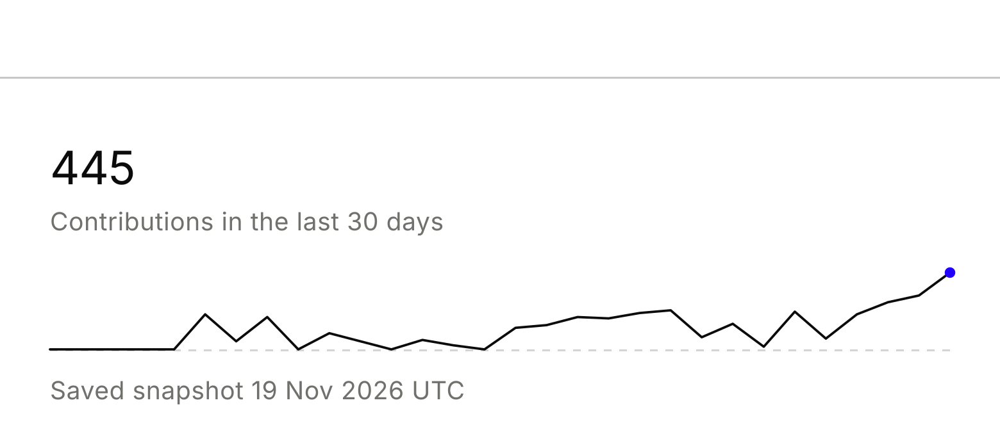</picture><picture><source media="(min-width: 512px) and (max-width: 767px), (min-width: 790px)" srcset="https://raw.githubusercontent.com/130U/130U/main/assets/ledger/blank.svg"><source media="(prefers-color-scheme: dark)" srcset="https://raw.githubusercontent.com/130U/130U/main/assets/generated/narrow-dark/contributions.svg">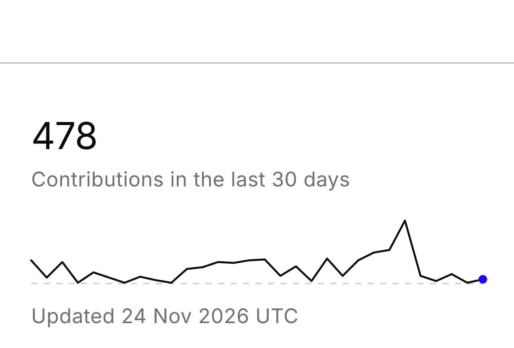</picture></a>

